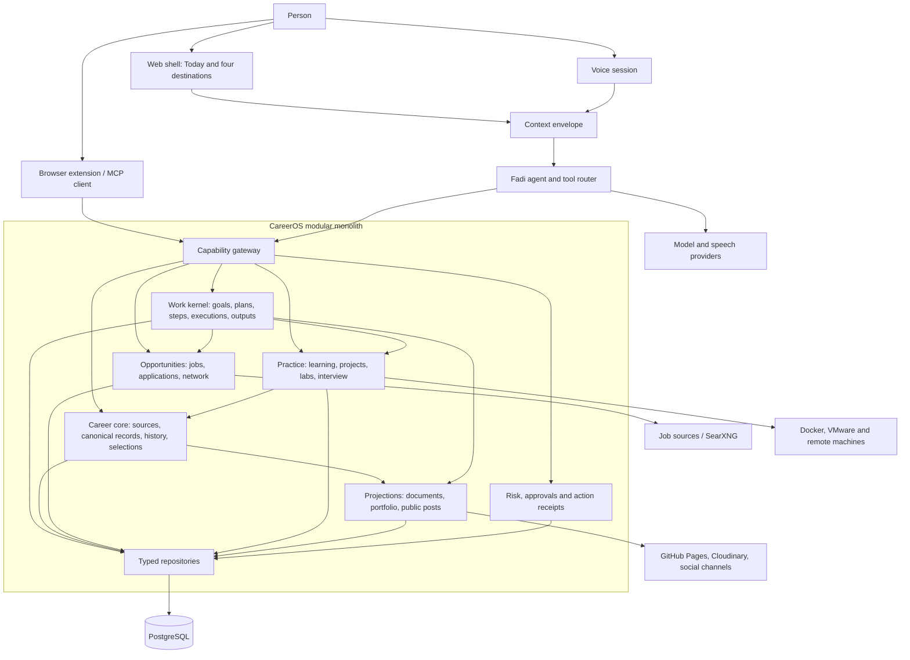

# Fadi architecture

**Status:** Current architecture with named target gaps

**Updated:** 23 September 2026

Fadi is a TypeScript modular monolith. Next.js serves React pages, server actions, HTTP APIs, the agent, and domain services. Drizzle repositories persist identity and product data in PostgreSQL. External model, job-source, publishing, media, voice, and machine providers sit behind adapters.

## Current foundations

### Work kernel

`work_items` represents goals, plans, and steps. `work_executions` records consequential attempts and their outcome. `work_outputs` links produced domain objects to the work that created them. Agent messages can be scoped to a work item, so conversation follows the task.

The kernel stores intent and coordination, not copies of domain content. A project remains a project record, a document remains a document, and a career fact remains an evidence item.

### Career core

Source documents are versioned before replacement. Canonical career records live in `evidence_items`; record versions preserve approved history. Selections express Auto, Include, or Exclude for a direction or job. Context snapshots freeze what a generator received. Documents and portfolio items remain projections.

This foundation exists but legacy rows and external-CV reconciliation are incomplete. Raw source text must not regain authority over reviewed records.

### Agent and capabilities

The active page and work item enter a shared context envelope. The tool router offers only relevant capabilities. Every registered tool declares `read`, `write`, or `external` risk; write and external operations declare their effect. Consequential calls create execution receipts.

The lab approval broker remains a specialised gate. A general policy engine, scoped grants, idempotency, reversibility metadata, and durable approval inbox remain target work.

### User interface

Today is the primary control surface. Navigation has four destinations defined in `apps/web/src/components/os/navigation.ts`. The old overview remains available as “The full picture.” Apply and Prepare are lifecycle phases; hiding routes by phase is retired.

### Events and background work

The current domain event bus is in-process and awaits subscribers. This is useful for local coordination but is not a durable delivery guarantee. Cross-domain side effects that must survive a crash need a transactional outbox and idempotent consumers.

### Voice

The current interview path records an answer, transcribes it after capture, and scores text. A Realtime endpoint exists, but voice is not yet one continuous, work-scoped Fadi session. Until that integration lands, describe the feature as voice input rather than a live voice agent.

## Data-flow rules

1. **Ingest:** preserve the exact source and its version.
2. **Interpret:** extract candidate facts with provenance and confidence.
3. **Resolve identity:** link only with strong anchors; otherwise ask or keep separate.
4. **Approve:** append an accepted record version. Unknown kinds remain unclassified.
5. **Select:** calculate relevance for a direction or job, then apply explicit overrides.
6. **Snapshot:** generators receive one immutable, inspectable context.
7. **Project:** create or update documents, portfolio entries, stories, and posts by stable record identity.
8. **Publish or act:** apply policy, obtain required approval, execute, and write a receipt.
9. **Learn:** feed verified outcomes back into work and the canonical record.

No downstream surface may silently create a second source of truth.

## Trust boundaries

- Browser input, imported files, scraped pages, job descriptions, model output, MCP clients, machine output, and published-site content are untrusted.
- Every user-owned query is scoped by the app user id.
- Provider credentials and machine credentials stay server-side and encrypted at rest where supported.
- Model output is data until schema validation, domain validation, and policy checks pass.
- Machine inspection is read-only unless a scoped capability authorises a mutation.
- Existing personal VMs are preserved through snapshot or clone workflows before disposable lab work.
- Social publishing uses separate consent and tokens from social sign-in.

See [security](SECURITY_AND_COMPLIANCE.md) and [agent guardrails](security/AGENT_GUARDRAILS.md).

## Known architectural gaps

The ordered gaps are maintained in [ROADMAP.md](ROADMAP.md) and [TECHNICAL_DEBT_REGISTER.md](TECHNICAL_DEBT_REGISTER.md). The most material are:

- Practice still exposes overlapping planning and completion flows.
- Interview matching can select a zero-relevance story; delivery coaching is inferred from text.
- Career legacy repair and external-CV reconciliation are unfinished.
- Cross-domain delivery is not durable.
- Voice, UI, and text do not yet share one Realtime session.
- Direct social publishing and its consent boundary do not exist.
- Job discovery needs measured source health and recall.

## Change rules

Use a repository/service boundary for database access. Keep pure decision logic separate from I/O. Add an ADR when changing ownership, a trust boundary, a durable delivery mechanism, or an external provider contract. Update this document when an architectural target becomes real or is abandoned.
