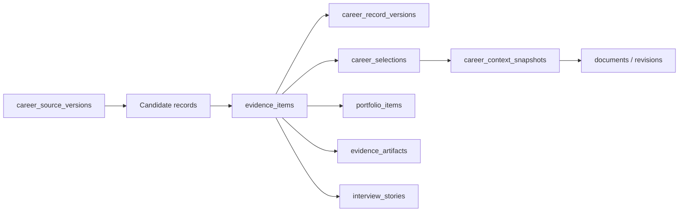

# Fadi data model

**Status:** Current ownership guide

**Updated:** 23 September 2026

The executable schema in `packages/database/src/schema/index.ts` and committed migrations are authoritative. This document explains ownership and invariants; it does not duplicate every column.

## Identity and account

`users` is the application identity used by domain repositories. Better Auth owns `user`, `session`, `account`, and `verification`; `auth_identities` links authentication identities to the application user. `profiles`, AI settings, MCP tokens, and provider connections are account-owned configuration.

All person-owned rows must be scoped through the application user id. Authentication ids are not domain ownership keys.

## Career core: one record, many sources and renderings

- `career_source_versions` preserves each imported or pasted source. Identical content is reused; replacing stored source text and recording its version is atomic.
- `evidence_items` is the canonical career record. Supported kinds include experience, project, education, certification, achievement, skill, and unclassified. A source that cannot be classified must never default to employment.
- `career_record_versions` is append-only history for accepted changes and withdrawals.
- `career_selections` stores Auto, Include, or Exclude at direction or job scope. Selection changes relevance, never record identity.
- `career_context_snapshots` records the exact facts and versions supplied to a generation run.
- `evidence_artifacts` stores optional proof media attached to a record.

Different résumé wording belongs in document revisions or fact renderings, not duplicate evidence items. Employer, date, title, issuer, credential id, and project identity are factual fields; audience-specific wording is presentation.

### Career invariants

- Preserve raw sources before interpretation.
- One real-world fact has one stable identity per user.
- Every canonical fact has at least one approved representation; transitions are transactional.
- A merge may combine provenance and renderings, but cannot silently inherit conflicting selection decisions.
- Unknown identity stays unresolved. Similar vocabulary alone is not an identity anchor.
- A withdrawn fact remains in history and is excluded from new projections.
- Projections reference a fact id. Title matching is only migration or recovery logic, never steady-state identity.

## Documents

`documents` owns a saved résumé, cover letter, or related output. `document_revisions` preserves edits. `resume_templates` owns layouts. A document's context snapshot is its freshness baseline; employer, title, date, description, selection, and withdrawal changes can make it stale.

A user can explicitly accept the current state as a new baseline, but that is an attestation, not proof that every sentence matches the career record.

## Portfolio

`portfolio_sites` stores site configuration and publishing state. `portfolio_items` stores presentation data and references a career record when the entry is a projection. `evidence_artifacts` owns proof media; Cloudinary/GitHub connections own provider state.

Sync is an identity reconciliation:

- a linked record updates the existing item without deleting media or presentation fields;
- a new eligible record creates one item;
- an intentionally hidden or presentation-only item is not recreated merely because a title is similar;
- deleted projections can return only when the person has not recorded an exclusion/tombstone decision.

Stable links and tombstones must carry this behavior; best-title matching without a score floor is unsafe.

## Work kernel

`work_items` is a tree of goal, plan, and step records. `work_executions` stores attempts, effects, resolved risk, timing, and outcomes. `work_outputs` links a domain object to the work that produced or used it. `agent_messages.work_item_id` scopes a conversation without making messages depend on the work item's lifetime.

The work kernel coordinates domains. It must not copy full job descriptions, career facts, project state, or document contents.

## Opportunities and progress

`jobs`, `job_occurrences`, and `saved_jobs` separate a normalised opportunity from source observations and user interest. `applications` owns the person's pipeline. `referral_targets`, resilience events, and momentum state support follow-up and process health.

A job score is advisory. Legitimacy and eligibility gates must be evaluated independently from fit; a high fit score cannot make a suspect posting safe.

## Practice

`learning_recommendations` and `learning_commitments` record guidance and commitments. `project_runs` and `project_steps` own practical execution. `lab_resources`, settings, grants, actions, and action requests own environments and approvals. `interview_stories` stores reusable grounded stories.

Current limitation: interview sessions, rubric snapshots, answer turns, and audio measurements are not durable records. Project and commitment completion still need one shared outcome service linked to the work kernel.

## Agent and observability

`agent_messages` stores conversation; `agent_runs` and `agent_findings` store scheduled analysis; `work_executions` stores consequential action receipts. `product_events` is analytics, not a source of truth.

Do not use analytics events to reconstruct domain state.

## Migration rules

- Generate and commit a migration for every schema change.
- Test invariants against real PostgreSQL when transaction, uniqueness, JSON, or concurrency behavior matters.
- Never rewrite an applied migration.
- Data repair is explicit, backed up, reversible where possible, and separate from schema creation.
- Do not backfill uncertain legacy meaning as fact. Mark it unresolved and ask.
