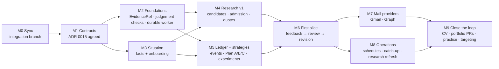

# Adaptive Career Loop: gap analysis and roadmap

**Date:** 20 Oct 2026
**Companion to:** ADR 0015 (contracts) and `2026-10-20-acceptance-scenarios.md` (tests)
**Status:** proposal, revision 2 (after Codex's review). Nothing below starts until both Claude
and Codex have signed ADR 0015 §7.

## 1. Gap analysis

**Legend:**
- **Reused:** used as it is.
- **Extended:** the existing code grows; there's no parallel version.
- **New:** nothing comparable exists.

Every "new" row says why nothing existing fits.

### Understand

| Capability | Status | Existing basis | Change |
|---|---|---|---|
| Career history as the source of truth | Reused | `evidence_items`, `career_record_versions`, `career_source_versions`, `lib/career/*`, `lib/identity/admit.ts` | None. Situation facts *reference* it. |
| Onboarding conversation | Extended | `app/onboarding/chat-actions.ts` (5 fields), the scripted form | CV first, then only the deciding questions. It writes situation facts and replaces the five-field chat. |
| Situation facts (right to work, dates, education, time, money, preferences, aspirations) | **New** | None. `career_profiles` has role, location and level; `profiles.job_preferences` has search settings | `situation_facts` (contract 1), using the versioning pattern of `career_record_versions` and the read-time freshness of `lab_observations` |
| Context assembly for model calls | Extended | `lib/agent/runtime-contract.ts` (bounded envelope), `career_context_snapshots` | Adds situation facts, permission-filtered (sensitive ones excluded by default) |

### Research

| Capability | Status | Existing basis | Change |
|---|---|---|---|
| Web search | Reused | SearXNG via `lib/jobs/web-search.ts`, `lib/research/recent.ts` | None |
| Official-source ranking and link checks | Extended | `lib/lab/plan-research.ts` | Generalised beyond lab planning |
| Labour and world signals | Reused | `lib/labor-market/bls.ts` (US), GDELT, `lib/intelligence/world-shifts.ts` | Ireland and EU sources are added as `primary_data` |
| Page reading, snapshots, dates, quotes, conflicts | **New** | Nothing stores sources or claims | `research_runs`, `research_sources`, `research_claims` (contract 2). The quote check reuses the logic in `rubric.ts`. |

### Plan

| Capability | Status | Existing basis | Change |
|---|---|---|---|
| Goal, plan and step structure | Extended | `work_items` (`kind: goal \| plan \| step`), `lib/work/plans.ts` templates | Strategies sit above plans |
| Career tracks | Extended | `career_profiles` (several per person, one active) | A strategy can point at a track; tracks stop being the only notion of direction |
| Plan A/B/C, person-originated plans, experiments, assumptions, activation conditions, revisions | **New** | Nothing holds alternatives with conditions or history | `strategies`, `experiments`, `strategy_revisions` (contract 5) |
| Deadlines computed from facts | **New** | `applications.deadline_at` is per application only | A conditional calculated deadline from an `authority: derived` situation fact, with exact rule, claim and input versions |
| Today shows the plan's next step | Extended | `lib/work/today.ts` (goal, next, what Fadi did, decisions) | "What am I trying to achieve" reads the active strategies |

### Act

| Capability | Status | Existing basis | Change |
|---|---|---|---|
| Opportunities, applications, documents, Practice, interview, network, portfolio | Reused | Their engines | Each also emits career events (through the outbox) |
| Tool registry | Extended | `lib/mcp/catalog.ts` annotations | Internal registry; MCP becomes one way to reach it (contract 4) |
| Permission gate, grants, audit | Extended | `lib/lab/policy.ts`, `lib/lab/broker.ts`, `lab_grants`, `lab_actions`, `lab_action_requests` | Generalised from lab resources to every tool capability |
| Execution receipts | Reused | `work_executions` (risk, approval, receipt) | Every tool call writes one |
| Portfolio changes as pull requests | **New** | `lib/portfolio/github.ts` publishes by replacing the whole repo | A `github.create_pr` tool against a source repo. Publishing stays behind `each_time` approval. |

### Observe

| Capability | Status | Existing basis | Change |
|---|---|---|---|
| Durable consequences | Extended | `outbox_events` and `lib/outbox/worker.ts` (lease, retry, idempotent) | Task kind, heartbeat, result, max attempts (contract 3) |
| Worker process | **New** | Request-time kicks, Today loads and the existing authenticated `/api/agent/run` scheduler | `scripts/worker.ts` uses the same dispatcher (Proxmox-capable). Existing entry points remain. |
| Career event ledger | **New** | `resilience_events` (momentum deltas), application `outcome` fields, outbox topics | `career_events` (contract 6). Application status becomes a projection; `resilience_events` folds in (open question 2). |
| Mail: paste and forward | **New** | None | Paste or forward a message, classified by the judgement gate |
| Mail: Gmail and Outlook read-only | **New** | `lib/email/send.ts` only *sends* | Provider adapters, after paste and forward work (milestone M7) |

### Learn

| Capability | Status | Existing basis | Change |
|---|---|---|---|
| Outcome proposes practice | Extended | `lib/work/outcome-learning.ts` | Becomes one kind of `adjust_tactics` inside a strategy review |
| Correlated-rejection awareness | Reused | `lib/applications/channel.ts` | An input to feedback findings |
| Coherence (the data agrees with itself) | Reused | `lib/agents/coherence.ts` | Also checks situation facts against the career record |
| Findings separate from hypotheses, gaps people report | **New** | `agent_findings` holds market findings only | `feedback_findings` (contract 7) |

### Adapt

| Capability | Status | Existing basis | Change |
|---|---|---|---|
| Background pass | Extended | `lib/agents/background.ts` (findings, digest) | Schedules strategy reviews through the worker |
| Strategy review with thresholds and switching cost | **New** | Nothing reviews a direction | `strategy_reviews` (contract 7) |
| Continuity without pressure | Extended | `momentum_states.resting_until`, "score the process" principle | Every proactive surface honours resting; momentum decay is never shown as failure |
| Action guardian | Reused | `lib/guardian/*` | Also warns when an action contradicts the active strategy, gently |

### Cross-cutting

| Capability | Status | Existing basis | Change |
|---|---|---|---|
| Lossless evidence references | Extended | Practice `self_reported`/`recorded`/`observed`/`verified`; steps `attested`/`evidenced`/`verified` | `EvidenceRef` preserves native scales and provenance; personal authority is separate (ADR §2.1) |
| AI-judgement gate | Extended | `rubric-eval`, `practice_grader_checks` | `lib/evaluation` with `judgement_checks` (contract 8) |
| Untrusted content handling | Extended | The rubric's untrusted block, `containsRubricGaming` | Shared wrapper for pages, mail and READMEs |
| Provider routing | Extended | `lib/ai/registry.ts`, `DocGenerate.identity` | A judgement runs only on a model that passed its check |

**Count:**
- 9 capabilities reused;
- 21 extended;
- 13 new;
- ten domain tables plus two support tables (`task_attempts`, `mail_candidates`), listed in
  ADR 0015 §6.

## 2. Roadmap

The order is set by dependency, not by size. The first complete slice is aimed at the owner's
30 Nov milestone. It includes pasted-mail candidates and a minimal durable worker; provider mail
integration and full recurring scheduling follow later.

| Milestone | Depends on | Delivers | Exit criterion | Proposed owner |
|---|---|---|---|---|
| **M0 Sync** | n/a | `integration/2026-10-20` (facelift and Practice merged) | Suite, migrations from empty, and the browser golden path all pass. **Owner approves before it becomes main.** | Claude prepared; owner approves |
| **M1 Contracts** | M0 | ADR 0015 accepted, with open questions answered | Codex and Claude sign the contracts; runtime-schema and transition test cases are specified, then delivered green with their implementation slices | Both |
| **M2 Foundations** | M1 | `EvidenceRef` (native scales untouched); `lib/evaluation` with full check binding; **minimal standalone worker**: outbox `kind: task`, fencing, per-item leases, `task_attempts`, cancellation, the same loop behind `/api/agent/run` and request kicks | Existing tests unchanged. The worker survives a restart, two overlapping workers, a stale completion and duplicate delivery, and a task runs with no page open | Claude (evaluation); Codex (worker) |
| **M3 Situation** | M1 | `situation_facts`; predicate registry and admission; onboarding that discovers constraints (conversation and UI) | Scenario A1: the owner's CV and answers give the expected facts and authority; unknown predicates are refused; the five-field chat is gone | Claude |
| **M4 Research v1** | M2, M3 | Tenant-owned runs; safe fetching; snapshots; `ExtractedClaimCandidate → AdmissionResult`; scope, freshness, conflicts and dependency-local blocking. Ireland permit routes first. | Scenarios A2, C and E pass; no calculated deadline from an unadmitted claim | Codex (fetch, store, admission); Claude (candidate semantics, eval set) |
| **M5 Ledger and strategies** | M2, M3 | Canonical `career_events` with projections (the `resilience_events` path); strategies linked by `planWorkItemId`, with Today's read path updated in the same slice | Scenario A3; Today still shows every open step; old and new projections match after backfill | Codex (events); Claude (strategies) |
| **M6 First slice** (target 30 Nov) | M4, M5 | Pasted mail → `mail_candidates` → the person confirms → canonical event → findings → review (with `DecisionPolicy`) → acceptance against base revision → Today. **Runs on the worker with no page open.** | Scenarios A4–A6, B and G pass end to end | Both; Claude leads reviews, Codex leads mail candidates |
| **M7 Mail providers** | M6 | Gmail (each person's own OAuth client) and Outlook (Graph `Mail.Read`) behind the M6 candidate path | Scenario D passes on provider mail; disconnecting deletes the token and raw messages | Separately assigned |
| **M8 Operations** | M6 | Recurring occurrences, time zones, catch-up, rest; scheduled reviews and research refresh | Scenario F passes; a missed week catches up once. "24/7" is claimed only after F. | Codex |
| **M9 Close the loop** | M7, M8 | Outcomes feed CV changes (claim-evidence gate), portfolio pull requests, Practice packs and targeting | A rejection with feedback leads to a practice exercise, then new evidence, then a CV proposal, each step traceable | Both |

### What runs alongside (no dependency on the above)

- **Claude:** the three incident Practice packs (suspicious sign-ins, Linux outage, access
  failure). They produce the owner's proof now, and they become `skill.evidenced` events once
  M5 lands.
- **Codex:** the 12 pending files are committed as `6024043` and merged into the Phase 0
  candidate; finish combined validation and hand it to the owner for promotion.
- **Owner:**
  - run a current, per-activity marking check on the chosen model; an earlier churn result
    does not qualify the new sign-ins suite or replace version-bound checks;
  - review this ADR.

### Deliberately postponed

- Specialist agent fleets.
- Microservices.
- A knowledge-graph database.
- Vector memory as a source of truth.
- Hosted research APIs.
- Autonomous submission of job applications. That stays `each_time` approval indefinitely.
