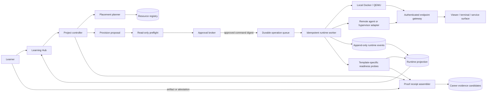

# Learning Hub and lab engine

Status: target architecture
Date: 2026-09-11

Implementation sequencing revised 2026-09-12: see the [agentic lab simplification review](../reviews/2026-09-12-codex-agentic-lab-simplification.md). Start with explicit target binding, one durable operation runner, and one guest action/check/continue journey. The records below describe distinct concepts; they are not a requirement to introduce every table or a separate orchestration service before that journey works. The runtime observer currently implements only part of this target.

## Product model

The Learning Hub has three durable places:

1. **Overview** answers “what should I learn next?” It shows the active career direction, the next project, the recommended route, and skills that still need proof.
2. **Projects** answers “what am I building?” A project behaves like a learning room: visible progress, one current task, a lab surface, and a separate evidence record.
3. **Machines** answers “where can this run, and what may Fadi do?” It owns resource inventory, discovery, permissions, approvals, runtime health, and the machine audit trail.

Tutorial links support a task. They do not define completion. A project step completes through a learner action, while evidence requires an artifact or a named machine observation.

## Runtime architecture

The worker owns execution. The web request creates or approves an operation and returns quickly. Refreshing the browser, changing pages, or restarting the Next.js process cannot lose the operation.

## Durable records

The database needs the following records in addition to the current project, step, resource, grant, request, and audit tables.

### `lab_runtimes`

- `id`, `user_id`, `run_id`, `resource_id`, `template_key`
- `phase`: `queued | pulling | creating | installing | awaiting_input | booting | ready | failed | stopping | stopped`
- `phase_detail`, `attempt`, `idempotency_key`
- `lease_owner`, `lease_expires_at`
- `created_at`, `updated_at`, `ready_at`, `stopped_at`

There may be multiple attempts for a project, but at most one non-terminal runtime per project and resource. A partial unique index can prevent concurrent active sessions; the transaction must still choose which attempt survives.

### `lab_runtime_events`

Append-only observations have `runtime_id`, monotonically increasing `sequence`, `kind`, `text`, `observed_at`, and optional structured progress. Progress contains an observed unit, completed value, and total value. It never stores a percentage inferred from elapsed time.

### `lab_runtime_endpoints`

Endpoints contain type and reachability, but never expose raw Docker host ports to the browser. The browser receives an opaque, user-scoped gateway path. The gateway verifies the authenticated owner, runtime status, endpoint allow-list, and session expiry before proxying.

Local ports bind to `127.0.0.1` using broker-assigned ports. Remote publishing is a separate operation with its own target network and approval. The present `0.0.0.0:8006` and `0.0.0.0:3389` behaviour must not be retained.

### `lab_readiness_checks`

Each template declares required checks. A check records its exact name, status, observation, and timestamp. Examples:

- viewer HTTP response: proves the setup console is reachable;
- a protocol-level RDP response from the identified guest: supports Windows service readiness; a TCP listener alone is insufficient;
- guest-agent health: proves the expected operating system booted;
- project service probe: proves the service required by the current task responds.

The runtime becomes ready only when its phase is `ready` and every required check passes. An empty check set cannot produce readiness.

### `project_proof_receipts`

A receipt separates four questions:

- completion basis: learner attestation or machine observation;
- attached artifacts;
- named checks and their observations;
- recorded assistance or guidance.

The audit log is not a proof receipt. Audit events explain what the system attempted. Proof receipts support a claim about a result. They may share runtime, step, and artifact identifiers without sharing meaning.

## Control flow

### 1. Plan

Convert the project into a typed lab specification. Eliminate resources with proven incompatibilities. Keep resources with unknown capacity in an `unverified` group and list the measurements needed. Among feasible resources, choose the least-capable machine that satisfies the requirement so larger or always-on hosts remain available.

Placement produces a proposal, not a running machine.

### 2. Preflight and approval

Preflight is read-only and reports the current effect: download size when known, free disk, memory pressure, occupied ports, existing names, files that would be replaced, and persistence implications.

Approval binds to:

- recipe and normalized parameters;
- rendered command digest;
- preflight facts shown to the learner;
- runtime, project, and step identifiers;
- actor and origin.

Immediately before execution, rerun preflight. If a material warning changed, hold the operation for review and clear any typed confirmation.

### 3. Provision

The approved operation enters a durable queue. A worker claims it with a renewable lease and an idempotency key. Every external side effect uses a deterministic runtime name and checks whether that exact owned object already exists before creating it.

The worker appends observed events and advances the phase transactionally. It may resume an expired lease. It must not repeat a completed destructive step merely because the previous worker died before acknowledging it.

### 4. Connect and become ready

Endpoint probing runs independently of readiness probing. A Windows viewer may become reachable during `installing` or `awaiting_input`; the UI can render it with the persistent message:

> Setup console connected · Windows is still preparing.

Tasks that require the installed OS remain unavailable until required readiness checks pass. Installation tasks may use the viewer earlier.

### 5. Stop, remove, and recover

These are separate operations:

- **Stop** preserves the runtime disk and can be reversed by starting again.
- **Remove runtime** deletes the compute instance while retaining explicitly persisted artifacts.
- **Remove including lab data** is irreversible and requires a typed confirmation.

Failure keeps the event stream and preflight snapshot. Retry creates a new attempt linked to the failed one. The UI shows the failed stage, last observed event, and next safe action.

## UI projection rules

The UI reads a projection assembled from durable records. It does not derive machine truth from the presence of a URL or from time elapsed.

| Engine fact | UI result |
|---|---|
| No runtime | Machine chosen; session not started |
| Pull with observed totals | Determinate progress using those totals |
| Pull without totals | Indeterminate stage plus latest event |
| Viewer reachable during install | Render viewer with “still preparing” banner |
| Installer needs input | `awaiting_input` callout and focus the viewer |
| Phase ready, checks pending | Console available; lab not ready |
| Required checks passed | Lab ready; unlock dependent task |
| Artifact attached | Artifact attached |
| Named machine check passed | Name the check and observation |
| Learner clicks complete without result | Self-reported; no artifact |

## Non-negotiable invariants

1. Resource registration does not grant control.
2. A model may propose a write; only a human approval may authorize it.
3. Approval covers the current effect and exact command, not a generic description.
4. Raw lab endpoints never bypass Fadi authentication.
5. Reachable does not mean ready.
6. Time elapsed never becomes invented progress.
7. Runtime state survives navigation and process restarts.
8. Every worker operation is owner-scoped, leased, and idempotent.
9. A machine observation proves only its named condition.
10. Learning evidence never arises automatically from an execution audit log.
