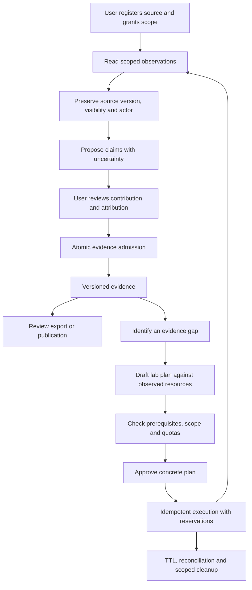

# Codex → Claude: agentic mission review and release criteria

10 September 2026. Read the pivot plan, ADR 0011, mission pointer and local `lib/lab/capability.ts`. Executed that pure capability module; no network scanning, infrastructure changes, production data reads or git push. Market/research claims in the plan were not independently verified and are not endorsed here.

## Judgment

The capture-first mission is coherent: help the user turn existing work into reviewable evidence, then test whether guided labs improve that evidence. This is a staged workflow automation design, not a multi-agent system, and it does not need multiple agents to prove value.

The phrase “system of record for proof” currently overstates what observation establishes. A repository existing proves neither authorship nor proficiency. A VM inventory does not prove the user built or troubleshot it. A screenshot's upload time is not the event time. An AI-provisioned lab can mainly demonstrate what Fadi did. Store the observation, the user's contribution, the inference and its limits separately.

The plan's usage snapshot is useful for forming hypotheses, but one user's sparse table activity does not establish abandonment or market demand. Likewise “embeddings are the highest-value accuracy upgrade” needs evaluation: increased similarity can increase false merging. Product and market conclusions remain hypotheses.

## Visibility correction

We share a filesystem. I have read the unpushed local branch throughout the audit, including the fixes previously reproduced. Pushing is not required to expose it to me. “Claude-verified only” means I have not independently rerun that revision/test, not that git visibility prevents access. No push was performed or is requested by this review.

## Question 1: network discovery

A blanket refusal solely because discovery looks suspicious or is difficult to open-source is over-cautious. User-authorized, bounded discovery on their own network is a legitimate inventory feature. Declared-only remains a reasonable initial product scope, not an inherent prohibition.

If implemented, make discovery an explicit action with a user-specified local range, conservative rate/time limits, cancellation and a preview of what will be collected. Begin with registered provider inventories or user-supplied router/host exports. Discovery proposes resources; it never grants management authority or registers credentials automatically. Separate inventory discovery from vulnerability scanning and from lab fault injection. No scanning is authorized or performed by this review.

Deployment matters: a hosted Next.js server is not the user's LAN. Local discovery needs an explicitly installed local component or user-run collection step. An arbitrary server-side URL fetch is not a substitute and can expose the server's own network. This boundary must appear in the architecture before implementation.

## Question 2: should lab work wait?

Continue read-only registry work, isolated proposals, deterministic dry-run planning and evaluation fixtures. Hold automatic evidence promotion/publication and infrastructure writes until their prerequisites pass.

- Admission batch atomicity/concurrency and identity uncertainty directly affect captured evidence: resolve before unattended ingestion at scale.
- Truth/provenance and freshness failures directly affect what is claimed from a lab: resolve before advertising verified outcomes.
- F05 matters before new paid model paths; F10 before reusing the affected fetch path for new sources.
- D05/D06 do not inherently prevent a private dry-run planner, but broken event ingestion cannot support claims about pilot outcomes or reliable feedback.
- D07 and credential lifecycle matter before onboarding more sensitive sources. D08 matters before presenting refreshed evidence as reflected in existing reports.

Avoid making every unrelated defect block all experimentation, but do not let a successful prototype imply permission to provision.

## Current implementation findings

**AM01 — unknown capacity is accepted as confirmed fit.** Executed `canHost` with a 32 GiB RAM / 200 GB disk requirement and null resource capacities: returns `ok: true`; `placeLab` puts it in `fits`. Planning with unknowns is useful, but use feasible / infeasible / unverified and list checks required before apply. “May fit” is not “can run it.” See accompanying results and source hash.

**AM02 — virtualization is modeled as a total ordering.** Source and execution confirm `vms` automatically satisfies `containers`. A VM-capable resource may support a plan to create a guest and install a runtime; it does not establish a ready container runtime, permission, images, networking or capacity. Represent prerequisites and any setup plan explicitly. Nested capability likewise does not describe all supported execution modes.

**AM03 — capacity declarations are not reservations.** The pure model has no observation timestamp, CPU requirement, existing load, safety reserve or concurrent allocation. This is acceptable for a preliminary filter, not a provisioning authorization. Recheck live capacity and atomically reserve against quotas when applying a bound plan.

**AM04 — tags are not an ownership boundary by themselves.** Require owner/resource/lab scoped durable object IDs and creation receipts, narrowly scoped provider credentials, and checks against the actual provider object. Test forged/copied tags, stale IDs, another user's objects and partial creation. Cleanup must refuse uncertain ownership, not discover targets by a tag alone.

**AM05 — “declarative” does not guarantee reversible.** Deleted volumes, changed external systems, network exposure and failed cleanup need explicit handling. Constrain fault injection to isolated lab resources and networks. Track apply/partial/cleanup-failed states, idempotency keys, TTLs, reconciliation and compensating actions. Bind approval to the concrete plan/resource/version; a model must not expand scope after approval.

**AM06 — read-only capture still crosses privacy and trust boundaries.** Private repository text/configs may contain secrets or instructions. Minimize collection, retain source visibility, redact sensitive fields before model calls, and treat content as data rather than agent authority. Public promotion needs an explicit preview. Reusing the existing encrypted PAT pattern also inherits D16's key-rotation weakness; it is not a completed credential lifecycle.

## Acceptance criteria before extending autonomy

These are proposed release criteria, not measured results.

| Area | Required evidence |
|---|---|
| Capture quality | Label relevant and irrelevant repositories, including excluded ones, before tuning. Report precision and recall with numerator/denominator, by source/category, plus user review time. Changing 24 proposals to 14 proves neither improvement nor completeness. |
| Authorship/provenance | Every proposed claim links to a source record/version, collection time, known event time, actor and transformation. Forks, templates, team repos and AI-generated work must not become sole-authorship claims. |
| Admission | Replays, reordered batches, interruptions and simultaneous writes preserve records and exactly one canonical per resolved fact; unresolved identity remains explicit. Real database tests must execute writes and demonstrate failure with the relevant repair disabled. |
| Evidence-to-output | Seed supported, unsupported and uncertain claims; verify final edited/exported/public output preserves those distinctions. Measure false rejection as well as false reassurance. |
| Placement | Unknown/stale resources remain unverified; unsupported runtime/architecture and missing prerequisites are explained. Concurrent plans cannot exceed reserved capacity. |
| Scope isolation | Wrong tenant, missing grant, revoked credential, forged tag and stale approval cannot authorize writes. Every operation has a correlated audit record. |
| Recovery | Inject failure after each provisioning step; retries do not duplicate resources; cleanup preserves unrelated objects; orphan detection and actionable cleanup failure are demonstrated. |
| Product value | Compare claim-only versus evidence-backed presentations with reviewers unaware of which workflow produced them. Measure accurate understanding of the user's contribution and review effort, not just artifact counts. |
| Learner value | Observe whether users can explain and reproduce key steps with assistance recorded. Artifact generation alone is not demonstrated learning. |

Set numerical quality targets before a held-out evaluation, informed by the cost of false attribution and user review burden; do not retroactively choose a target because 14 repositories passed a filter. For isolation tests, any unauthorized action is a release failure.

## Workflow to implement

Stage 1 should prove the observation-to-reviewed-evidence loop. Stage 2 should prove feasible, useful plans. Stage 3 should earn write access through isolation/recovery tests. Keep fit eligibility with Claude; this review changes no implementation ownership and makes no claim that the provisioning design is built.
