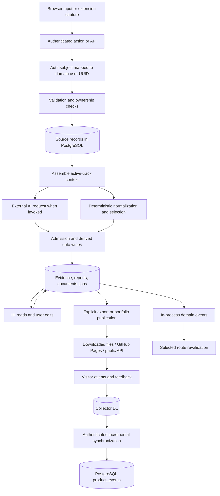

# Fadi data lifecycle and architectural judgment

10 September 2026. Scope: the current local Fadi/CareerOS working tree, not the separate Firebase portfolio or Python JobSpy runtime. This review follows application actions, repositories, schema, model-context assembly, identity admission, publishing and collector synchronization. No production records, credentials or external AI requests were used.

**Judgment:** Fadi has a reasonable storage architecture, but an incomplete data lifecycle. It is much stronger at collecting and displaying records than at preserving their identity, provenance, freshness, consistency and eventual deletion across every representation. A reliable database does not make all transformations built on it reliable.

The system is changing. The collector now contains a durable cursor fix absent in the September 9 audit; the current implementation introduces different cursor problems documented below. Historical audit findings must not be treated as automatically current. The executable probes in this folder record SHA-256 hashes of the exact source versions tested.

## 1. Where data lives

| Location | What it holds | Authority and ownership |
|---|---|---|
| Browser/UI | Form state, editor buffers, selected views, preferences and local state | Unsaved state is not durable; the browser is not a trusted authorization boundary |
| Better Auth tables: `user`, `session`, `account`, `verification` | Login identity, sessions and provider/account records | Authentication authority |
| Domain `users` and `auth_identities` | Application user UUID and mapping to external login subject | Domain ownership root; distinct from Better Auth user ID |
| `profiles` | Name, onboarding completion and account-level preferences/integrations | User-wide profile |
| `career_profiles` | Directions, active direction, role/location/goals, semantic information | Per-user directions; many workflows implicitly read whichever is active now |
| `linkedin_profiles` | Pasted/imported LinkedIn text and reference URL | User-wide source material; source label does not prove accuracy or completeness |
| `resumes` | Raw/parsed base résumé text, file descriptors, optional track association | Input material, separate from generated document artifacts |
| `evidence_items` | Structured work/projects/qualifications, metrics/tags, origin, fact ID and canonical/rendering flags | Shared evidence pool, with direction-specific presentation computed later |
| `jobs` + `job_occurrences` | Canonical vacancy and individual provider observations | Public catalog when owner is null; private captures have an owner UUID |
| `saved_jobs` + `applications` | Saved opportunities versus actual application workflow state | Separate user-owned entities; neither should be casually substituted for the other |
| `documents`, `career_reports`, templates | Generated/edited artifacts, report results, metadata and associations | Derived artifacts and user edits, not automatically synchronized with source changes |
| Learning, interview, referrals, resilience and agency tables | Commitments, stories, networking targets, activity and agent results | Supporting workflow state |
| `agent_messages` | Persisted user/assistant conversation text | User-scoped history; persistence is best-effort in the chat handler |
| `portfolio_sites`, `portfolio_items` | Curated publication settings and public-facing content | Public presentation is a separate representation of private evidence |
| KV: memory or Upstash | Job-sync reservations/status, liveness results and rate counters | Operational state; memory fallback is process-local and volatile |
| Cloudinary | Uploaded media assets | Separate remote lifecycle; deleting a DB URL is not deleting the asset |
| GitHub repository / GitHub Pages | Built static site and its published files/history | Remote snapshot; changing the local DB does not inherently change it |
| Cloudflare Worker + D1 | Public visitor events, feedback and associated context | Independent public ingestion store; pulled into Fadi later |
| `product_events` | Imported/local analytics and feedback payloads | Owner link is nullable with `ON DELETE SET NULL`, not cascade |
| External AI providers | Request inputs needed for generation, embedding and voice | Data leaves Fadi when invoked; provider-specific retention was not verified |
| Application logs / backups | Operational identifiers, failures, and whatever DB backups operators configure | Retention and restoration need an explicit operating policy; not demonstrated by source alone |

## 2. Main movement of data

Arrows describe data dependencies, not a single atomic transaction. Model calls, filesystem builds, PostgreSQL commits and remote publication do not share an atomic boundary.

## 3. Workflow: how, where and when

### A. Login and identity resolution

On an authenticated page/action, `lib/auth/session.ts#getCurrentAuthUser` asks Better Auth for the session. It resolves the auth provider subject to a domain user using `users.repository.ts#findOrCreateFromAuthIdentity`.

A lookup can therefore cause a write: existing identities receive updated last-seen/profile fields; a missing mapping causes a transaction inserting the domain user and identity link. Good: domain tables do not depend directly on a vendor-specific login ID. Risks: repeated resolution creates write traffic; concurrent first resolution can race before the insert transaction; DB failures are caught and returned as null, which can look like a logged-out user rather than an infrastructure outage.

### B. Onboarding

Trigger: submit onboarding. `app/onboarding/actions.ts` validates, writes profile with completion false, updates/creates active direction, optionally inserts LinkedIn text and a résumé, then marks onboarding complete.

After the response, `after()` attempts evidence extraction. This uses source material and an AI provider and then admits structured items. Onboarding may succeed while extraction fails or lacks a provider. That is acceptable if the UI distinguishes “profile saved” from “evidence ready.” It is not a guaranteed durable background job.

The source writes are sequential and are not in one transaction. A late failure can leave a changed profile/direction or new résumé despite an error response. A retry can append another import. A pasted LinkedIn URL is stored as a reference/raw value; this path does not fetch the full LinkedIn page merely because a URL was entered.

### C. Profile edits and active directions

Trigger: Save Profile or save résumé from Evidence. `updateProfileAction` updates profile, active career direction, invalidates job-sync state, updates latest LinkedIn material and writes the track-specific résumé. It revalidates Profile and Dashboard.

`getLatestForTrack` prefers a résumé attached to that direction. Only the oldest direction may inherit an untagged legacy résumé; newer directions without one return null. This is a useful isolation rule, but callers must preserve the distinction between “no source for this direction” and “no experience.”

Blank résumé text does not clear the stored résumé. Both blank LinkedIn inputs leave the old record unchanged. Empty therefore means “preserve” here rather than “delete.” The UI should expose an explicit clear action or distinguish omitted and empty values.

Many operations resolve “active track” afresh on the server. This needs an explicit track ID for workflows that can stay open while another tab switches directions; otherwise context selection can drift between the page shown and the action executed.

### D. Evidence extraction, admission and identity

Trigger: background onboarding extraction, Build Evidence, manual entry, extension, imports or learning completion.

`composeCareerEvidence` gives sufficiently long LinkedIn text precedence and labels the résumé a supporting excerpt. Extraction submits a bounded text prompt, receives structured candidates, and passes them through `lib/identity/admit.ts`.

Admission compares candidates with canonical existing records. It may create a new fact, attach a wording to an existing fact, promote a human version over a machine version, or flag a conflict. This is a good intention: one real event should not become several projects merely because it has several descriptions.

But the storage invariant is not consistently enforced. New canonical rows can have null fact IDs; admission promotion uses separate insert/update writes; repository merges are not atomic/idempotent. See reproduced defects below. Treating fuzzy identity as a fact-management decision requires stronger boundaries than ordinary display deduplication.

Also, `origin` conflates ingestion route and authorship. Learning completion collects `whatIBuilt` in the person's own words, assigns origin `learning`, and `authorshipOf('learning')` classifies it as machine-written. That can affect which version leads. Store channel, author, transformation and attestation separately.

### E. Job ingestion and discovery

Trigger: jobs-data load/search, refresh/background agency. `startBackgroundSync` reserves a 30-minute search scope in KV, writes a running status with a 10-minute TTL, and detaches discovery. The scope includes role/domain/region/geography, rather than a user ID, because the provider catalog is shared.

Provider results are normalized and each observation is upserted. This part has a strong boundary: canonical job upsert + occurrence upsert + reaggregation occur in one PostgreSQL transaction with a row lock. Partial unique indexes separate public versus per-owner private canonical identity.

Canonical identity currently uses normalized company + title + first location segment. It does not prove vacancy identity: two requisitions for the same title/company/city can collapse. Occurrences preserve provider observations, but downstream applications and liveness still attach to the canonical job.

Description selection favors the longest text, including updates to the same occurrence. This prevents teasers overwriting full descriptions but also prevents a newer, shorter correction from replacing obsolete text. Freshness and completeness are different properties.

The run counts successful upserts but retires seed data and runs stale-job archival whenever discovery returned postings, even if every upsert failed. A completed status can therefore describe a run that persisted nothing. Track discovered, persisted, rejected and failed counts separately.

### F. Ranking and AI context

Trigger: display opportunities, ask Fadi, evaluate fit, prepare an application.

Role/seniority/location heuristics rank candidates; cached embeddings can rerank/rescue results. Embeddings use the server OpenAI key directly in `lib/ai/embeddings.ts`. The evidence duplicate-discovery path sends evidence titles, organization, detail and tags to this embedding function. Choosing a different BYOK chat provider does not route every model request to that provider.

Chat context reads the active direction, latest source texts, latest ready report, saved jobs, momentum and agent findings. It truncates inputs and optionally loads market information. The chat route explicitly requests live market context. These are multiple reads, not a versioned snapshot of the user's state.

The base chat context does not automatically load the structured evidence pool; a separate tool can retrieve it. Thus ordinary chat and document generation can reason from different source selections. More context is not automatically better, but the source contract should be explicit.

The context builder labels a filtered saved-job count as active applications and fills saved-role title/company with generic placeholders. That is a real model-input quality issue: a fluent answer cannot recover precise state that was not supplied. Read actual application state and join actual job identifiers/details.

### G. Documents and conversation history

Trigger: generate/edit a document or send a chat message.

Document generation composes current history, selected evidence and a clipped JD, calls the configured provider, applies style/truth heuristics and stores a document linked to track/job/application. Structured evidence is largely converted to prompt prose; the schema lacks a dedicated immutable evidence-version → claim mapping. Current document updates match user + document ID, overwrite fields and update timestamp; there is no expected-version precondition in that repository method.

Consequences: later source edits need not update existing outputs; two editors can overwrite each other; a document may have been valid against earlier evidence without retaining a reproducible record of exactly which input versions were used. Snapshotting is appropriate for an application already sent, but it needs visible lineage, not silent drift.

Chat persists the user message without awaiting the write; assistant history saving catches failures. A streamed reply can reach the browser even if the durable history does not. This favors responsiveness, but the product should not imply that every visible conversation is safely saved. Record message IDs and save state, and deduplicate retries.

### H. Learning completion

Trigger: mark a commitment complete with a description of the work. The current implementation inserts evidence and completes the commitment inside one transaction. That is a meaningful correctness improvement.

However, the “already completed” read happens before the transaction. Two concurrent requests can both see incomplete, then each insert evidence. A transaction groups writes; it does not by itself make this precondition concurrency-safe. Lock/recheck the commitment inside the transaction or claim it with a conditional update and unique completion key.

Momentum and events intentionally run after the core transaction. Preserve that separation if a reward failure must not lose evidence, but make derived side effects replayable so “best effort” does not mean permanently forgotten.

### I. Portfolio and external copies

Trigger: curate/sync evidence, publish in Fadi, or publish to GitHub.

Evidence changes currently trigger a portfolio-route refresh through the event subscriber. They do not silently rewrite public content, which protects user control. Published content is selected into a public view; a static build writes files and pushes them to GitHub. Media resides in Cloudinary. These are independently retained copies.

Current collector cursors are stored inside `portfolio_sites.theme`, and `toSiteView` passes theme through to the public view. These counters are not credentials, but operational ingestion state does not belong in public presentation settings. Whole-JSON read/merge/write operations also risk overwriting concurrent theme/cursor changes.

Unpublishing locally is not equivalent to retracting a GitHub Pages build, downloaded document, Cloudinary asset, or repository history. Publication should have destination, version, deployment status and withdrawal status per target.

### J. Visitor analytics and feedback

Trigger: visitor interaction on a public portfolio; later owner-triggered synchronization. Events/feedback go to the public Worker/D1, then an authenticated export supplies a page of records to Fadi. Fadi inserts them into `product_events` and advances a cursor.

The current fix separates scanned progress from imported rows and filters by handle, addressing the earlier starvation design. But event sync also writes feedbackCursor, and the Worker labels the entire table maximum as `scanned` even when its result page is limited. These are different data-loss bugs described below. Independent streams require independent offsets and page-aware continuation tokens.

### K. Deletion and account closure

Trigger: Delete My Data versus Close My Account. The former deletes the domain user but keeps login; the latter resolves linked Better Auth IDs and deletes both identity roots in a transaction. The distinction is sensible and the transactional closure is a good boundary.

The “everything” language is nevertheless too broad. `product_events.user_id` uses `ON DELETE SET NULL`; payloads survive, including synchronized feedback text/name/contact. No matching cleanup is present in these deletion actions. Nulling an owner ID is not removing all potentially identifying content.

Remote collector rows, published GitHub files/history, Cloudinary media, provider-held data, downloaded files and operator backups require their own retention/withdrawal policy. This is a technical lifecycle gap, not a legal-compliance conclusion. Preserve enough destination inventory to clean remote copies before deleting the credentials/links needed to do so.

## 4. Where information leaves Fadi

| Invocation | Data leaving | Destination | Control question |
|---|---|---|---|
| Job/market discovery | Search role, region and selected relevance parameters | Configured providers/search sources | Is the scope of each provider request documented? |
| Document/evidence/fit generation | Selected candidate history, evidence, JD and instructions | Selected AI provider | Which input version, provider/model and purpose were used? |
| Chat | Message/history + assembled career context | Primary/fallback model chain | Can the user see fallback routing and what is persisted? |
| Embeddings | Track/job text and, for identity matching, evidence details | Server-key OpenAI embedding endpoint | This is separate from BYOK chat selection |
| Speech/transcription/realtime | Audio or text depending on route; realtime uses direct browser-provider session | Speech/model provider | Each mode needs its own clear data-flow description |
| Media upload | Image/video/document bytes | Cloudinary | What deletes the object and enforces upload policy? |
| GitHub publication | Selected portfolio data embedded in built files | User's repository/Pages | What tracks the deployed version and removal? |
| Analytics/feedback | Events, visitor pseudonym/context, submitted message/contact | Collector D1, later PostgreSQL | Are page offsets, retention and owner deletion correct? |
| Optional integrations/MCP | Data selected by the invoked integration/tool | Notion, GitHub or MCP client as applicable | Permissions and export scope need endpoint-specific testing |
| Upstash configured | Operational keys and values, some containing IDs/search scopes | Redis REST service | TTL is not a durable audit or deletion ledger |

This table identifies code-level destinations, not the providers' current retention/training terms. Those were not assessed here.

## 5. New failures and concrete consequences

Status: **P** = actual current functions executed with synthetic boundaries; **S** = source-confirmed control flow/schema; **R** = architecture/concurrency risk requiring integration testing.

| ID | Priority/status | Failure and consequence | Required correction |
|---|---|---|---|
| D01 | High / P | Merge fresh rows whose fact IDs are null: absorbed row is not matched by the group update and stays canonical | Initialize fact identity; merge by explicit IDs/group membership transactionally |
| D02 | High / P | Repeat a merge when both rows already share a fact ID: group demotion also demotes the keeper, leaving zero canonical rows | Idempotent same-group guard, transactional promotion and DB invariant |
| D03 | High / P | Admission promotes new human wording, but returns the old pre-update object/ID | Return inserted canonical row; link callers to stable fact rather than obsolete rendering |
| D04 | High / P | Batch promotion maps placeholder fact ID but does not map `lead='batch-0'` to the inserted row | Resolve every temporary reference; atomic admission. A real UUID query may throw rather than silently no-op after the inserts |
| D05 | High / P | Event sync sets feedbackCursor to the event ID. Example: events at 1000 cause next feedback request `after=1000` even when feedback is unread | Separate stream state and remove cross-stream write |
| D06 | High / S | Worker returns first 1000 events/200 feedback rows but reports table max ID as scanned; client jumps past undispatched rows | Cursor = last record in this page, not global high-water mark; snapshot-safe pagination |
| D07 | High / S | Account/data deletion preserves product-event payloads through SET NULL | Delete/redact owner payloads deliberately; define remote and backup lifecycle |
| D08 | Medium / P | Delete all evidence: max surviving updatedAt becomes null; reportStaleness says fresh | Monotonic evidence revision/change log that includes deletions |
| D09 | Medium / S | Profile/onboarding/track deletion have multiple independent writes | Transaction per domain operation; distinguish committed data from derived jobs |
| D10 | Medium / R | Learning precheck and evidence identity resolution occur before transactional write; concurrent calls can both pass | Lock or conditional claim plus unique idempotency key |
| D11 | Medium / S | Latest résumé/document edits overwrite current rows without compare-and-swap/version history | Revisions, expected version on save and conflict UI |
| D12 | Medium / S | Company/title/city dedupe equates distinct requisitions; longest-description merge rejects shorter corrections | Preserve source IDs and versions; conservative equivalence with provenance |
| D13 | Medium / S | A discovered batch with zero successful writes can still retire seeds and report completed | Commit-aware outcome semantics and success gating |
| D14 | Medium / R | Detached discovery can die while shared reservation lives for 30 minutes | Durable leased job, heartbeat, bounded retries and terminal status |
| D15 | Medium / S | Chat context substitutes saved-job state/placeholders for application data | Explicit read model from actual applications and job joins |
| D16 | Medium / S | Login secret also derives encryption key for stored integration credentials | Separate versioned data-encryption key and key-rotation/re-encryption plan |
| D17 | Medium / S | Learning channel is interpreted as machine authorship even for user-written descriptions | Separate source channel, actor, transformation and attestation |

D01–D04 use the actual admission/repository functions with in-memory seams. These establish execution paths and returned values, not PostgreSQL locking behavior. D04's mixed-authorship batch is an API-level edge case; ordinary AI-only extraction batches do not inherently hit it. D02 can arise from a repeated/stale merge action. Findings are not claims that every existing user's records are already corrupted.

## 6. Principal architect judgment

**What I would keep:** PostgreSQL as the authoritative store; typed repositories; explicit user scopes; public/private job separation; provider occurrence records; user-controlled portfolio publication; atomic job ingestion and atomic account closure; pure, testable decision functions.

**What I would change:** the fact model and lifecycle contracts. Fadi currently gives several things the role of truth: LinkedIn prose, base résumé, canonical evidence, generated report and user-edited document. Those should be related sources and projections with explicit precedence/versioning, not silently competing truths. A long LinkedIn paste is not intrinsically more current or correct than a newly corrected CV.

The highest-risk pattern is that successful local steps are treated as successful workflows. “Saved,” “merged,” “synchronized,” “fresh” and “deleted” each need a precise invariant. Otherwise the application can confidently describe a state that its data does not actually support.

Examples of invariants:

- A fact has a stable ID and exactly one chosen canonical rendering.
- A failed/retried merge cannot hide or duplicate the fact.
- A generated artifact records which source versions and model produced it.
- A source deletion increments the same revision as a source update.
- A sync offset only advances over records durably processed in that stream.
- A completed import distinguishes accepted records from failures.
- Account closure has an explicit result for every retained destination.

## 7. Recommended target model and workflow

```mermaid
flowchart LR
  IN[Input / upload / capture] --> SRC[Versioned source artifact]
  SRC --> PROP[Extraction proposals with provenance]
  PROP --> FACT[Stable evidence fact]
  FACT --> WORD[Versioned human or AI rendering]
  FACT --> OUTBOX[Transactional outbox]
  OUTBOX --> JOB[Leased background job]
  WORD --> SNAP[Versioned context snapshot]
  SNAP --> GEN[Generation with provider / prompt version]
  GEN --> DOC[Document revision and claim links]
  DOC --> REVIEW[Review against current revisions]
  REVIEW --> PUB[Publication record per destination]
  PUB --> REMOTE[Remote artifact]
  REMOTE --> RETAIN[Retention and withdrawal tracking]
```

Implement inside the existing monolith; this does not require microservices. Suggested schema concepts:

- `source_artifacts`: owner, type, source version/hash, imported timestamp, original/reference and extraction status.
- `evidence_facts`: stable ID, owner, revision, canonical rendering pointer, lifecycle state.
- `evidence_renderings`: fact ID, text, actor, channel, model transformation, source reference and version.
- `document_revisions` / `generation_runs`: source versions, track/job snapshot, provider/model/prompt version, output and review state.
- `outbox` / `jobs`: operation ID, owner, state, attempts, lease and error category.
- `ingestion_offsets`: collector identity, stream, handle and monotonic offset; unique imported event key.
- `publications`: content version, destination, remote IDs, deployed/withdrawn state.
- `deletion_jobs`: destination cleanup outcome and retry state, without retaining content unnecessarily.

Use a pointer from a fact to its canonical rendering rather than loosely coordinated boolean flags. If retaining the existing flags, enforce the equivalent uniqueness/ownership constraints and transactions. Keep operational cursors out of `theme` JSON.

## 8. Order of work and acceptance tests

1. **Prevent loss/hiding:** D01–D07 first. Tests: replay merges; merge null and same-group records; import multiple pages; event/feedback IDs diverge; delete a synthetic account and inspect remaining payloads.
2. **Make workflows atomic and repeatable:** onboarding/profile/track operations, conditional learning completion, idempotent admissions and sync uniqueness. Test concurrent calls and injected failures after every write boundary.
3. **Add versioned provenance and freshness:** sources, evidence revisions, document versions and publication snapshots. Test editing/deleting evidence after generation and conflicting editor saves.
4. **Separate operational state from content:** durable job leases, offsets and publication/deletion ledgers. Test process interruption, restart and duplicate delivery.
5. **Improve semantic correctness:** source-aware job identity, newer corrections, real application context and explicit model routing. Test the quality of the information delivered to the decision layer, not only SQL success.

Measure durable record completeness, duplicate fact rate, conflicting canonicals, stale-but-unflagged outputs, dropped sync records, failed-job recovery time, and remote deletion coverage. Those measures establish whether the data platform works. Counts of stored rows or passing pure tests do not establish it by themselves.

## 9. Source evidence and limitations

All paths below are relative to `/home/mirzzie/Projects/careeros-transfer-20260601-205559/careeros`:

- `apps/web/src/app/onboarding/actions.ts`
- `apps/web/src/app/dashboard/profile/actions.ts`
- `apps/web/src/app/dashboard/tracks/actions.ts`
- `apps/web/src/app/dashboard/evidence/actions.ts`
- `apps/web/src/app/dashboard/learning/actions.ts`
- `apps/web/src/lib/auth/session.ts`
- `apps/web/src/lib/identity/admit.ts`
- `apps/web/src/lib/career/evidence.ts`
- `apps/web/src/lib/career-report/data.ts` and `staleness.ts`
- `apps/web/src/lib/ai/context/builder.ts`, `embeddings.ts`, `user-generate.ts`
- `apps/web/src/app/api/fadi/chat/route.ts`
- `apps/web/src/lib/documents/generate.ts`
- `apps/web/src/lib/events/bus.ts`, `register.ts`, `types.ts`
- `apps/web/src/lib/portfolio/subscribers.ts`, `collector-sync.ts`, `build-export.ts`
- `apps/web/src/lib/jobs/sync.ts`, `data.ts`, and `lib/kv/store.ts`
- `apps/web/src/lib/security/crypto.ts`
- `packages/database/src/schema/index.ts`, `canonical.ts` and repositories for users/evidence/resumes/documents/jobs/product-events`
- `packages/portfolio/src/view.ts`
- `infrastructure/portfolio-collector/worker.js`

Executable evidence: [probes.cjs](probes.cjs), [results.json](results.json). No real account erasure, cloud withdrawal or live concurrency/load test was performed. The assessment does not establish deployed database constraints, external retention policies or real-world exploitation. Existing source was read, not modified; only audit artifacts were written.
