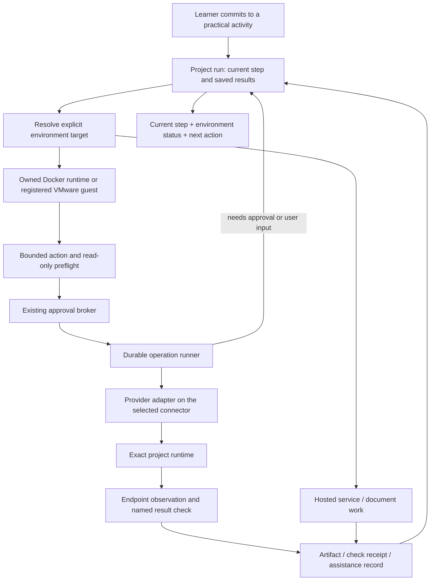

# Agentic learning and lab engine: direction, simplification, and handoff

Date: 2026-09-12
Reviewer: Codex
Reviewed checkout: `feat/lab-resources`, HEAD `2ec1c1f`.
Scope: recent Claude changes from the Learning Hub rebuild through distribution-aware planning, plus the execution paths those changes rely on. Source review and isolated automated tests; no fresh browser, live model, Docker, VMware, or remote-machine journey was run in this review.

## Judgement for the owner

Claude is moving toward the intended product, but the implementation has not reached the intended autonomy. The useful progress is real: committing produces a project, the workspace focuses on the current task, the planner knows more about the lab distribution, approvals show effects, and both provider implementations can take multiple tool rounds. Keep those changes.

The drift is in implementation strategy: repairing generated prose with more keyword rules and preparatory machine activity, while the durable connection between the selected host, approved operation, guest interaction, and observed result remains incomplete. The current system is a guided project workspace with lab launch support. A successful nginx launch does not establish that Fadi can complete an arbitrary practical project or work inside an existing VMware guest.

The central product promise should be: **commit → prepare the appropriate environment → work on the current step with Fadi → check the result → keep the evidence → resume later.** Preparation is a means to learning, not a separate management project.

This review also corrects Codex's earlier design. The runtime observer and the target architecture document contain assumptions I helped introduce. They require the same scrutiny as Claude's code.

## Reproduced and changed in this working tree

| ID | Finding | Change and regression evidence |
| --- | --- | --- |
| A01 | Planning invoked `docker run --rm` to look up packages before approval. The temporary container can cause image pulls and repository downloads; it is not a read-only host observation. Each probe allowed 90 seconds, with a second probe on repair. | Removed the automatic probe, its process cache, and the unused prose-to-package parser. The real planning function now saves package-install instructions without invoking that broker entry point. The test failed before the change and passes afterward. |
| A02 | The package lookup script used `;` after repository updates, allowing a failed update to become a negative package result. Missing output could also be reported as a completed check. In a reproduced planner call, the parser treated the verification command `openssl version` as packages `openssl` and `version`. | Removed this validation path instead of extending its shell and prose heuristics. Static OS/distribution contradiction checks remain. Package availability is now unverified at planning time; actual package validation must happen in the approved environment. This is a deliberate reduction in assurance claims, not a claim to solve unavailable packages. |
| A03 | A SaaS name or writing task anywhere in a description suppressed its lab, even when local execution was explicitly requested. | Kept lab recommendations for “Deploy nginx locally and write a runbook”, “Install a local collector and send logs to Grafana Cloud”, and “Build a Docker integration for Salesforce”. All three previously returned no lab. This is a compatibility repair to a heuristic, not a complete intent classifier. |
| A04 | Hosted projects were subjected to local hardware eligibility before deciding that they needed no lab. A ServiceNow task mentioning Windows Server incidents could be rejected because the only registered machine was an ARM board. | No-machine projects no longer require a local eligible host or save an unrelated resource assignment. The planner regression executes through saving, and checks the saved resource ID is null. |
| A05 | Generic terms such as monitoring, SIEM, dashboard, and log collection became mandatory always-on hosting requirements. This excluded a learner's laptop from short practice exercises. | Continuous availability now needs explicit wording such as “24/7” or “always on”. The existing continuous-monitoring test now states the requirement; a separate evening-practice regression checks that it is not invented. |
| A06 | OpenAI-compatible tool execution discarded a completed answer after tools and made another model call solely to regenerate it as a stream. | Return the answer already produced; retain the streamed fallback for empty responses and the round limit. Removed an unused across-run set. The test observes two calls rather than an attempted third, and preserves the original answer. |

Planning's initial and repair passes now use one static validation function. The schema maximum also matches the prompt's existing eight-step maximum. Passing this function means only that the known contradiction checks found nothing. It does not mean that a command ran or that a project is feasible.

Changed production paths:

- [Planner](../../apps/web/src/lib/lab/plan-run.ts)
- [Recommendation heuristics](../../apps/web/src/lib/lab/spec-from-project.ts)
- [Broker](../../apps/web/src/lib/lab/broker.ts)
- [OS and distribution helpers](../../apps/web/src/lib/lab/host-and-lab.ts)
- [OpenAI-compatible tool loop](../../apps/web/src/lib/ai/providers/openai.ts)

Regression paths:

- [Planning boundary tests](../../apps/web/src/lib/lab/planning-boundaries.test.ts)
- [Project requirements tests](../../apps/web/src/lib/lab/spec-from-project.test.ts)
- [Tool loop tests](../../apps/web/src/lib/ai/providers/tool-loop.test.ts)
- [Retained distribution checks](../../apps/web/src/lib/lab/host-and-lab.test.ts)

The removed package lookup's three opt-in Docker tests and six parser tests were removed with the feature. They are not being presented as passing integrations. Ten new behavioral cases were added across the planning and tool-loop files. The initial focused run had eight failures before repair; the others protect retained behavior.

## The more consequential gaps still open

These are source-confirmed implementation gaps, not live exploitation results or claims that every possible journey fails.

### A07 — The displayed host is not reliably the execution target

[Planning](../../apps/web/src/lib/lab/plan-run.ts) picks a registered resource but uses `process.platform` for its host OS. That is the Fadi server's OS, not necessarily the chosen host's or the learner's laptop's OS.

[Project actions](../../apps/web/src/app/dashboard/learning/lab-actions.ts) special-case VMware endpoints, then otherwise propose a local `lab.start` without binding the selected resource into its execution parameters. The [AI start tool](../../apps/web/src/lib/ai/tools/registry.ts) also proposes `lab.start` directly. A registered remote resource can therefore be named in planning while the local Docker process is the execution path. This is a target-integrity problem, not a cosmetic label problem.

**Next change:** resolve one explicit target containing owner, resource ID, connector identity, provider, and runtime identity. Use it for placement, approval, execution, status, and stop/resume. A missing remote connection should lead to “Connect this machine” with an actionable setup path; it must never silently redirect work locally.

### A08 — Provisioning is synchronous, while its request row looks durable

[The broker](../../apps/web/src/lib/lab/broker.ts) claims an approval and executes process commands inside the request. The generic command timeout is 60 seconds. The [observer](../../apps/web/src/lib/lab/runtime-observer.ts) interprets an approved request as “creating”. A stored request alone does not provide restart recovery or reconcile an uncertain external effect.

**Next change:** add a small durable operation runner with a lease, deterministic runtime identity, and explicit reconciliation after interruption. Reuse existing request and audit records where appropriate; do not introduce an event bus, separate workflow framework, and many new tables as prerequisites. Persist enough state to resume the current operation and distinguish failed execution from unknown outcome.

### A09 — A listening port is being promoted into readiness

[The observer](../../apps/web/src/lib/lab/runtime-observer.ts) checks fixed loopback ports. Windows becomes ready when a TCP connection to 3389 opens; PostgreSQL and web readiness similarly use a TCP listener. The observer does not establish that the answering service is the intended guest/service. An inspect exception becomes “stopped”, although an unavailable Docker daemon is not evidence of a stopped container.

VMware's last successful suspend request can override a subsequent manual resume. A running VM is given a reachable viewer endpoint even though the observer has no viewer session to return.

**Next change:** inspect the exact owned runtime and its actual bindings, then use a service-specific handshake or guest health check. Store observation time and unknown status. Keep viewer availability separate from guest readiness. Match real observations before making stop/resume claims. These defects include Codex-authored code; they are not solely Claude's errors.

### A10 — The browser-session contract is ahead of the implementation

[The contract](../../apps/web/src/lib/lab/runtime-contract.ts) says session paths are opaque gateway handles. The observer returns raw loopback HTTP URLs. That only works under specific local browser/server arrangements and is not the authenticated gateway described in the design.

**Next change:** implement an owner-scoped session endpoint for connected runtimes. Local native VMware console launch remains a separate supported access mode until a browser transport exists. Do not advertise a null native console path as a browser session.

### A11 — The agent loop is not yet a project execution loop

The [tool registry](../../apps/web/src/lib/ai/tools/registry.ts) can plan, inspect, propose a launch/build, read project status, and record completion. It does not expose a general scoped guest action and proof-check path. A five-round provider loop also has no demonstrated durable continuation from a later human approval into the next project action.

**Next change:** a project runner should pause on the existing approval request and resume after its outcome, then perform one bounded guest action, run that step's named check, and save the result. Start with one Linux exercise and one existing VMware guest. Expand templates after both paths work through reconnect and failure recovery.

### A12 — Replanning can erase the history that learning needs

[`replaceSteps`](../../packages/database/src/repositories/project-runs.repository.ts) transactionally deletes all existing steps and inserts new ones, including removal of their completion/artifact records. It can also replace the resource assignment while the existing runtime remains elsewhere. The transaction prevents partial deletion; it does not preserve history or runtime identity. The UI warns about replacement, so this is not an undisclosed deletion claim.

**Next change:** preserve completed steps and their receipts. Replace only the remaining draft or create a plan revision. Keep runtime reassignment an explicit operation. The learner should be able to improve a plan without erasing what they already accomplished.

### A13 — Learning type and proof are still too coarse

[`labNeedFor`](../../apps/web/src/lib/learning/needs-lab.ts) declares every course/certification item machine-free regardless of practical work in it. The need belongs to an activity within the course, not the item label.

A textual artifact field is also not proof that a file exists. The UI's distinction between self-report and machine checks is useful, but calling any typed description an attached artifact overstates what has been collected. A machine result must not become a claim of unaided mastery.

**Next change:** reuse the same practical activity model inside projects, courses, and practice. Store separately: reported completion, captured artifact, named machine observation, and assistance used. Let users demonstrate learning with a short explanation or repeat attempt; do not infer it from container state.

## The simpler architecture I now recommend

Keep the monolith and the existing approval broker. Use one project orchestration path with Docker and VMware adapters, and a connector only where a machine is remote. A provider adapter answers “how do I act on this runtime?”; it does not create a second product workflow.

This is a target, not a diagram claiming these missing pieces are implemented. It narrows the earlier [architecture proposal](../architecture/learning-lab-engine.md): begin with the minimum durable operation and proof record, then split storage/projections when actual usage warrants it. Separate concepts do not automatically need separate services or tables.

For an existing laptop VM, connection can use a paired local connector and an explicit guest endpoint. Keep credentials on that connector; the model receives scoped runtime IDs and capabilities. Bind approved actions to the selected runtime and command/script digest. Guest commands operate inside the lab, with time/output/resource limits; they do not inherit unrestricted host access. Recheck materially changed preflight facts, retain revocation, and report uncertain outcomes before retries. These controls enable the requested automation rather than requiring the learner to approve every keystroke.

A reusable lab session can authorize a bounded class of project operations for a stated period. Changes outside that scope—new host mounts, public exposure, destructive reset, expanded network access—need their own decision. That is a proposed policy evolution, not authority granted by this review or something implemented in this patch.

## UI and learning judgement

Keep three primary destinations: **Overview, Projects, Machines**. Activity can be a secondary view. A project should show its objective, one current task, the environment's actual state, and one next action. Put the transcript, command details, resource controls, and full audit trail behind deliberate expansion. Show approvals globally, but keep one decision surface per operation rather than duplicated cards competing for attention.

Use the reference platforms' useful pattern—task, workspace, visible progress—without borrowing competition mechanics as evidence of learning. A clear “Continue project” is more useful here than a wall of hardware permissions or scores.

Preparation should be expressed as one short sequence: “Choose environment → Review setup → Preparing → Continue”. If no environment is needed, omit the preparation sequence. If a viewer opens during installation, label it “Setup console”; do not render “Ready” until the guest check passes. Allow learners to read the next task while the environment prepares.

The psychological risk is false progress: successful provisioning feels like successful learning, and a green check beside machine state can be read as endorsement of the person's ability. Keep task completion, working output, and learning demonstrated distinct. Offer hints and explanations before taking over; record assistance without penalizing it or pretending it was unaided work. These are design judgements from the observed failure patterns, not findings from a user study.

## Verification and next handoff to Claude

- Before repair: focused new cases produced **8 failures and 9 passes** across the two test files.
- After repair: focused lab/provider run **282 passed, 28 skipped**.
- Full normal suite: **1,068 passed, 39 skipped**; 112 test files passed, 10 skipped.
- Database and web typechecks passed.
- ESLint passed on changed files; `git diff --check` passed.
- Docker/package integrations, real providers, remote hosts, and VMware guest interaction were not exercised. The tests establish the targeted code behavior, not the full product promise.

Claude: A01–A06 are changed and verified in the working tree; review the diff before taking ownership. A07–A13 remain open. Prioritize target binding, resumable operations, and a single guest action/check/continue journey. Please demonstrate: the chosen machine executes the action; approving elsewhere resumes the same step; an interruption does not duplicate a side effect; a listening installer never marks the guest ready; and evidence survives replanning. More templates and prompt repair rules can wait for that evidence.
