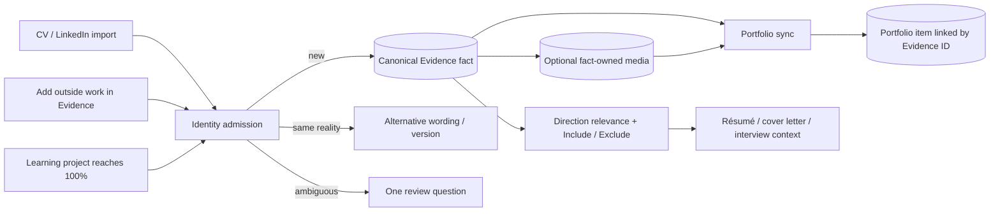

# Evidence, portfolio, directions, and learning — corrected system model

**For:** owner and Claude  
**Date:** 2026-09-22  
**Status:** implementation and architectural decision

## Decision

Fadi has one canonical pool of career facts: **Evidence**. A résumé import, a manually entered
project, and a completed Fadi lab are intake channels. They are not parallel sources of truth.

A record is one real thing: an employment, project, achievement, certification, skill, or education
item. Its wording can vary by direction or job without becoming a second fact.

Media is an optional relation to a fact. A screenshot, video, repository, or write-up strengthens a
project; its absence does not make the project invalid and must not produce a public “no evidence”
warning.

The portfolio is a projection. Its row points to the Evidence record it presents and can add
presentation fields such as layout, public wording, cover, gallery, order, and visibility. Deleting a
projection does not delete its Evidence fact or fact-owned media. Sync can recreate the projection
unless the user explicitly chooses “do not show this fact.”

A career direction is another projection over the same pool. It ranks and selects facts; it does not
copy them.

## Correct workflow

### Work completed inside Fadi

The final completed project step settles the run and saves one grounded Evidence project exactly
once. The text is derived from the recorded step results. The person can correct it in Evidence.
Optional media can be attached there. Portfolio Sync creates or links the public project.

### Work completed outside Fadi

Use **Evidence → Add one by hand** for one item, or **Add more history** for a CV/history import.
The same editor accepts optional media or source URLs. There is no separate “portfolio project
truth” form.

### Portfolio sync

1. If a portfolio item already has the Evidence ID, do nothing.
2. If an unlinked item has a high-confidence identity match, link it and preserve its wording/media.
3. If there is no match, create one projection in the correct section, with or without media.
4. If identity is ambiguous, do not guess. Ask one pairwise question.
5. A dismissed fact remains in Evidence but Sync does not publish it again.
6. A database unique constraint prevents two portfolio rows on one site from pointing to the same
   Evidence record.

This makes duplicate prevention an identity invariant rather than a title-string convention.

## Direction behavior

Fadi already has the right storage boundary:

- one Evidence fact;
- per-direction and per-application `Auto / Include / Exclude` choices;
- one captured context snapshot used by document generation.

Its current automatic classifier is weaker than the data model. It compares tokens, fuzzy stems,
AI-produced `marketTags`, the direction title, and job text. It can rank “SIEM” for
“Cybersecurity Analyst,” but it does not actually understand that Cybersecurity contains SOC,
GRC, IAM, cloud security, application security, DFIR, and other branches. Its score is lexical,
not an occupational ontology.

The next direction upgrade should stay small:

1. Give every normalized skill and occupation a stable concept ID.
2. Store aliases and parent/child/related relationships in a versioned taxonomy.
3. Map each Evidence fact to concepts with `source`, `confidence`, and review state.
4. Map a direction to one or more occupation concepts and required/preferred skills.
5. Derive an explainable relevance score from those relationships.
6. Keep `Include / Exclude` as the human override. A model suggestion never overwrites it.

Do not create a copied “Cybersecurity Evidence pool.” The view is
`Evidence × Direction taxonomy × user override`.

## Why this matches established systems

LinkedIn describes its Skills Graph as a common, maintained taxonomy with IDs, aliases, and
relationships that downstream products reuse, rather than each feature inventing its own skill
strings:
[LinkedIn Skills Graph](https://www.linkedin.com/blog/engineering/skills-graph/building-linkedin-s-skills-graph-to-power-a-skills-first-world) and
[skills taxonomy maintenance](https://www.linkedin.com/blog/engineering/data/building-maintaining-the-skills-taxonomy-that-powers-linkedins-skills-graph).

ESCO publishes a standardized occupation/skills classification and skill-to-occupation matrices.
It is a better seed for EU/Irish direction mapping than asking an LLM to rediscover the job market
for every user:
[ESCO](https://esco.ec.europa.eu/en) and
[skills–occupations matrix](https://esco.ec.europa.eu/en/about-esco/publications/publication/skills-occupations-matrix-tables).

Salesforce’s identity architecture links source records into a unified entity while retaining the
source records; matching and reconciliation are explicit policies. That is the correct mental model
for several CV wordings of one career fact:
[Salesforce Data 360 architecture](https://architect.salesforce.com/docs/architect/fundamentals/guide/data-360-architecture) and
[identity resolution](https://developer.salesforce.com/blogs/2024/10/data-cloud-and-identity-resolution).

Contentful models entries and assets as separate linked resources. That is why Fadi media now
belongs to the Evidence fact as an optional related resource rather than deciding whether the fact
exists:
[Contentful data model](https://www.contentful.com/developers/docs/concepts/data-model/) and
[links](https://www.contentful.com/developers/docs/concepts/links/).

W3C PROV-O provides the vocabulary Fadi should use as provenance expands: entity, activity,
agent, derivation, and attribution:
[W3C PROV-O](https://www.w3.org/TR/prov-o/).

## What changed in this implementation

- projects and achievements now sync even without media;
- achievements have their own CMS section;
- public project cards and case pages no longer display a missing-media accusation;
- text-only projects can lead the public portfolio;
- Evidence accepts optional uploads and source/media URLs for outside work;
- media is stored against the stable Evidence fact and survives projection deletion;
- the normal sync planner links same named work or creates new work; the proof-only side channel
  was removed;
- user-facing “Pull in proof” language now says “Sync evidence”;
- the final completed Learning project step saves one Evidence record automatically;
- the “Finish without evidence” bypass was removed.

## Remaining boundary

Fadi should not silently replace existing curated portfolio wording on every sync. Evidence is
authoritative for identity and factual fields; portfolio prose/layout is a presentation. A later
update policy should show “source changed” and offer **Apply factual updates**. That is a small,
reviewable projection rule, not another content store.

The taxonomy upgrade should follow this change. Building a large graph before the canonical
fact/projection boundary is stable would add infrastructure around incorrect semantics.

## Verification

- Full web suite: **1,259 passed, 94 skipped**.
- Database and web TypeScript checks: clean.
- Targeted lint: zero errors; one pre-existing React effect warning remains in the Learning
  workspace polling code.
- Read-only plan against the owner's current local account after this change:
  `evidence: 13, portfolio: 33, create: 0, link: 0`. Sync would not add or relink anything
  today.

