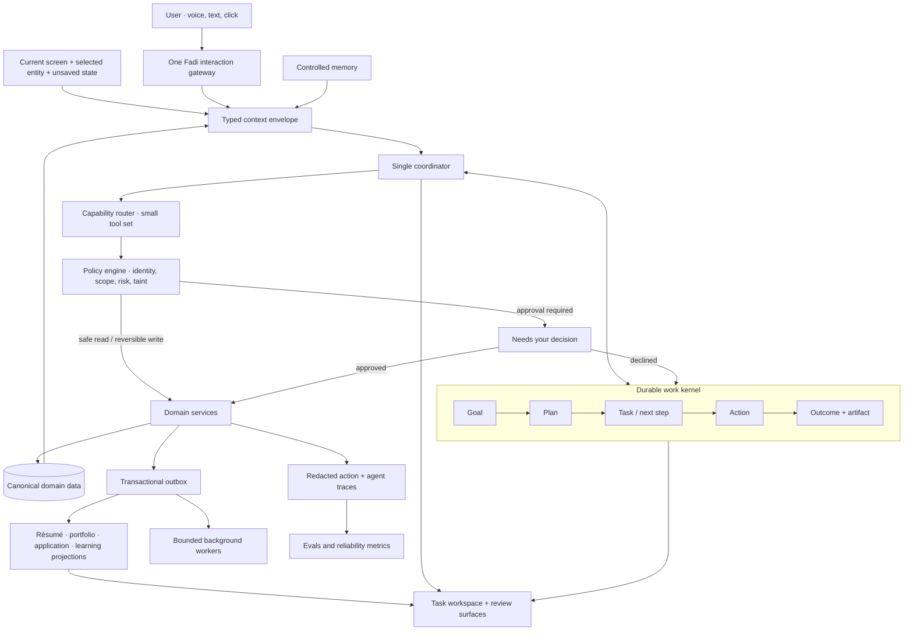

# Fadi as a coherent agentic career platform

**Date:** 2026-09-22  
**Basis:** code review of the current authenticated shell, routes, Fadi chat and voice paths, AI tools, context builder, background agent, event bus, approvals, data schema, and the recent screenshots and usability reports. External recommendations are based on the primary sources listed at the end.

## Principal judgment

Fadi has a capable **feature architecture**, but it does not yet have a complete **agent architecture**.

The platform already has strong parts: a canonical career record, per-direction selections, documents, job discovery, applications, portfolio publishing, interview preparation, practical learning, guarded machine actions, background findings, and an assistant with 27 callable tools. The problem is that these capabilities are presented and executed as separate applications. The user must still remember where to go, move information between areas, trigger syncs, interpret different statuses, and reconstruct the larger goal.

That is why Fadi feels as if it “has everything” while also feeling disconnected. Its database stores career entities and conversations, but it does not store the user's **current mission as durable work**: goal, plan, steps, action status, decision points, generated artifacts, outcome, and what should happen next. Chat history is not a task model. Background findings are not a task model. An Apply/Prepare UI mode is not a task model.

The correct product is a **task-first, multimodal career agent with visual workspaces**. Voice, text, and direct manipulation should be three ways to operate the same Fadi session and the same durable task. The graphical interface remains essential for comparison, review, editing, evidence, and high-impact confirmation. “Voice oriented” should mean the whole product can be driven naturally by voice; it should not make the product voice-only.

My recommendation is to stop adding top-level features until the shared agent and journey layer exists.

## Current assessment

These scores are architectural and heuristic judgments, not results from a fresh moderated usability study.

| Area | Judgment | Evidence |
|---|---:|---|
| Capability breadth | **8/10** | Career record, jobs, applications, documents, portfolio, networking, interview, learning and labs all exist. |
| Career-data grounding | **7/10** | The new evidence, version, selection and context-snapshot model is a solid base. Legacy data and external reconciliation remain risks. |
| Cross-feature coherence | **3/10** | Twenty authenticated page routes, ten dock apps, manual projections, page-specific workflows, and no durable end-to-end mission. |
| Agent continuity | **3/10** | One global message history exists, but there are no goal, plan, task, action, artifact or outcome records. |
| Context awareness | **3/10** | The chat context includes profile, evidence, analysis, saved jobs, market, findings and momentum, but not the current route, selected entity, unsaved state, active task or pending decision. |
| Voice experience | **4/10** | Batch transcription and TTS work. A Realtime WebRTC broker exists but no client uses it, and it has separate instructions without Fadi's tools or career context. |
| Action safety | **7/10** | Lab preflight, scoped grants, global approvals, reversal text and audit records are unusually thoughtful. Equivalent policy is not yet uniform across every tool and external action. |
| Cognitive simplicity | **3/10** | The interface exposes internal domains, modes and administration. Several controls depend on icons, hover labels or product vocabulary. |
| Accessibility readiness | **5/10** | Semantic labels exist in many components, but the icon dock, dense global bar, hidden mode-dependent destinations, motion, and complex panels need full WCAG and assistive-technology testing. |
| Observability and evaluation | **4/10** | Logs and background ledgers exist. There is no end-to-end agent trace model, journey evaluation suite, or product-level outcome measurement. |

## What is causing the disconnected feeling

### 1. The navigation mirrors the codebase

The authenticated product exposes Home, Evidence, Portfolio, Jobs, Applications, Network, Interview, Learning, Profile and Settings in the dock, with more pages beneath them. This makes the user choose the subsystem before Fadi has understood the job to be done.

The dock labels are mainly revealed on hover. That is weak for touch, voice control, cognitive accessibility and new users. The fixed dock also competes with page actions and the floating Fadi orb.

Relevant code:

- `apps/web/src/components/os/dock.tsx`
- `apps/web/src/components/os/menu-bar.tsx`
- `apps/web/src/app/dashboard/**/page.tsx`

### 2. Apply/Prepare is an artificial global mode

Real career work overlaps. A person may inspect a job, notice a gap, practise it, update evidence and return to the application in one session. The mode switch hides whole areas and redirects the user to Home if the current page belongs to the other phase. That makes the platform stateful in a way the user has to remember.

Modes can still exist as **Fadi's prioritisation context**, but they should not remove navigation or strand a task. The current mode switch should become a goal or focus choice such as “Get a job,” “Build a skill,” or “Improve my profile.”

Relevant code:

- `apps/web/src/app/dashboard/mode.ts`
- `apps/web/src/components/os/career-mode.tsx`
- `apps/web/src/components/os/dock.tsx`

### 3. Fadi cannot see what the user is looking at

`buildFadiContext` includes the active direction, canonical career context, prior analysis, job counts, market data, background findings and momentum. The chat request does not include the route, selected job/project/document, highlighted content, form state, or task being performed.

If the user opens a job and says “Is this worth it?”, Fadi should not need the user to paste or name the job. A modern contextual assistant needs a small, typed **context envelope**, not a bigger system prompt.

Relevant code:

- `apps/web/src/lib/ai/context/builder.ts`
- `apps/web/src/app/api/fadi/chat/route.ts`
- `apps/web/src/components/fadi/fadi-chat.tsx`

### 4. Conversation persistence is being mistaken for memory and continuity

`agent_messages` is one user-wide sequence. The client reloads recent messages and sends the last 20 turns back on every request. There is no conversation thread linked to a job, project, document, or goal. There is no server-owned working state that says “we are on step 3 of applying to this role.” Different topics can pollute one another, and a long task can fall outside the 20-turn client window.

The message writes are also best-effort. That is acceptable for a transcript, but it cannot be the authoritative state of an agentic task.

Relevant code:

- `packages/database/src/schema/index.ts` (`agent_messages`)
- `packages/database/src/repositories/agent-messages.repository.ts`
- `apps/web/src/app/api/fadi/chat/route.ts`

### 5. The “background agent” is a scheduled scanner

The background pass refreshes jobs, detects new or closed roles, checks market signals, notices stale learning commitments and runs coherence checks. It records honest findings, which is a good design. It does not resume a user's mission, wait for dependencies, continue a multi-step plan, or produce a durable result for later review.

Call it background intelligence until it has durable task execution. This sets an honest mental model.

Relevant code:

- `apps/web/src/lib/agents/background.ts`
- `packages/database/src/schema/index.ts` (`agent_runs`, `agent_findings`)

### 6. Every chat turn receives the whole tool catalogue

The chat exposes 27 tools to every tool-capable provider. That increases tool-selection ambiguity, prompt size and the number of unsafe combinations the policy layer must reason about. It also makes every tool description responsible for compensating for absent task and context state.

Use one coordinator and a deterministic capability router. The router should select a small tool set from the current intent, entity and risk tier. This is simpler than a multi-agent swarm and easier to secure and evaluate.

Relevant code:

- `apps/web/src/lib/ai/tools/registry.ts`
- `apps/web/src/lib/ai/tools/types.ts`

### 7. Realtime voice exists as an unused island

`/api/fadi/realtime` creates an ephemeral OpenAI Realtime session with server VAD. Nothing in the client calls that endpoint. The visible Fadi conversation instead records audio, waits for silence, uploads the clip for transcription, sends text through the ordinary chat route, waits for a TTS request, and then resumes listening. It is half-duplex and cannot provide genuine barge-in or one continuous session.

The unused realtime session also has a short generic prompt with no canonical career context, current task, tools, approvals or shared conversation thread. Wiring it directly to the UI in that form would create a second, less-informed Fadi.

Relevant code:

- `apps/web/src/app/api/fadi/realtime/route.ts`
- `apps/web/src/components/fadi/fadi-chat.tsx`
- `apps/web/src/lib/voice/use-groq-voice.ts`
- `apps/web/src/lib/voice/fadi-speech.ts`

### 8. The event seam is sound but too narrow and non-durable

The typed domain-event bus currently defines three portfolio/evidence events and registers one portfolio subscriber. It is process-local, awaited and deliberately non-durable. That is a reasonable first seam, but it cannot reliably connect all career journeys, retries, background work and projections across instances.

Keep immediate in-process notifications for UI invalidation. Add a transactional outbox for durable cross-domain consequences. Do not turn every function call into an event.

Relevant code:

- `apps/web/src/lib/events/types.ts`
- `apps/web/src/lib/events/bus.ts`
- `apps/web/src/lib/events/register.ts`

### 9. Fadi does not currently “learn all user actions”

`product_events` primarily records public portfolio analytics. Career preferences exist in several domain-specific fields, but there is no general preference-memory model and no policy for observed behavior, inferred preference, confirmed preference, confidence, scope, expiry or correction.

That absence is better than silently learning everything. Recording every click would create noisy memory and a privacy problem. Fadi should learn **useful, explainable preferences** from selected events and let the user inspect, correct and forget them.

## The product model Fadi needs

Fadi should be organised around this loop:

> **Understand the goal → make a visible plan → do safe work → ask for decisions → produce an artifact → record the outcome → update the career record → suggest the next step.**

The LLM interprets language, resolves ambiguity, drafts content and proposes plans. Deterministic application code owns authorization, invariants, state transitions, selection, data writes, execution and retries. The model must never be the database or the policy engine.



### Minimal durable work model

Avoid a large workflow framework at first. Four additions are sufficient:

1. **Work items** — goal, plan and step in one hierarchical table: type, parent, status, owner, active direction, context references, due date, created reason.
2. **Executions** — each model/tool attempt: work item, tool, actor, risk tier, correlation ID, status, timestamps, error, approval reference and redacted trace reference.
3. **Artifacts** — documents, evidence, portfolio items, recordings, lab outputs and links created or used by a work item.
4. **Preferences/memories** — typed value, scope, source, confidence, confirmation state, expiry, sensitivity and last-used time.

Reuse existing domain tables. Do not duplicate jobs, applications, evidence or documents inside the work kernel; reference their IDs.

### The context envelope

Every text, voice and UI request should carry the same server-validated structure:

```ts
type FadiContextEnvelope = {
  userId: string;
  threadId: string;
  activeDirectionId: string | null;
  activeWorkItemId: string | null;
  surface: "web" | "voice" | "extension" | "mcp" | "background";
  route: string | null;
  entityRefs: Array<{ type: string; id: string }>;
  selection?: { kind: string; text: string };
  pendingDecisionIds: string[];
  permissionSnapshotId: string;
  careerContextSnapshotId: string | null;
};
```

The browser can propose route and selection context, but the server must re-authorize and load referenced entities. The client must never be allowed to inject another user's record into the agent context.

## A simpler whole-product interface

The strongest alternative is a **task-first shell**, not a prettier dock.

### Global navigation: four destinations

| Label | What the user expects | Existing areas absorbed |
|---|---|---|
| **Today** | What matters now, current mission, next action, decisions | Dashboard, briefing, momentum, activity |
| **Opportunities** | Find, compare, apply and follow up | Jobs, Applications, Network, interview prep tied to a role |
| **Practice** | Learn and build proof | Learning, projects, labs, machines when needed |
| **My career** | The trusted record and things shared from it | Evidence, documents, portfolio, profile, directions |

Settings belongs in the account menu. Machine administration belongs under Practice → Lab setup and should appear only when a project needs it. “Niche finder” is an action Fadi offers while creating a direction, not a destination. Reports are views inside Today or My career, not their own app.

Use visible text labels at every viewport size. A four-item mobile bottom navigation can use icon plus text. Desktop can use a compact left rail or top navigation. Hover-only labels should not carry meaning.

### Replace the current home page with “Today”

The first screen should answer four questions in this order:

1. **What am I trying to achieve?** — one active goal, switchable.
2. **What should I do next?** — one primary action.
3. **What is Fadi doing?** — active or recently completed work with honest status.
4. **What needs my decision?** — approvals, ambiguities and review items.

Show at most three optional suggestions after the primary action. Move market feeds, impact counters, reports and momentum details behind “Why this?” or into a secondary view. The current dashboard has several independently useful cards but no dominant work sequence.

### One Fadi surface

Keep one persistent Fadi control. Opening it shows:

- the current task and step;
- a context chip such as `Using: SOC Analyst · Acme Support Engineer · résumé v4`;
- the conversation for this task;
- the plan and live action status;
- Talk/type controls;
- Pause, cancel and undo where available.

The command bar and Fadi chat should be one interaction surface. Search results can be returned by Fadi's deterministic “find anything” capability. Remove separate mental models for command, chat and conversation mode.

### One inbox, with decisions kept distinct

The existing decision queue correctly distinguishes “has not happened” from notifications. Preserve that distinction inside one **Inbox** entry point:

- **Needs your decision** — never marked read merely by opening; shows exact effect and expiry.
- **Done by Fadi** — action receipts and artifacts.
- **Suggestions** — dismissible findings.

Critical or blocking decisions remain visible in Today and beside the affected task. An icon in a global bar should not be the only route to them.

### Plain-language vocabulary

| Current term | User-facing term |
|---|---|
| Evidence | **Career record** or **My experience** |
| Evidence item | **Record** |
| Career track | **Direction** |
| Mission Control | **Today** |
| Agent finding | **What Fadi found** |
| Machine access | **Lab access** |
| Sync evidence | Usually automatic; when required, **Review changes** |
| Canonical / projection / snapshot | Keep internal; say **source**, **used in**, **saved version** |

“Simple enough for a child” should mean literal language, visible labels, predictable placement, one primary action, reversible steps and examples. It should not mean removing expert capability. Use progressive disclosure: a novice sees the next action; an expert can open details, raw commands, provenance and history.

## How the main journeys should work

### Apply to a role

1. User says, “Help me apply to this,” while viewing a job.
2. Fadi already has the job ID and active direction in the context envelope.
3. Fadi creates a visible five-step plan: verify role → assess fit → tailor résumé → prepare message/letter → user submits.
4. Safe reads and drafts run automatically. Each step updates in place.
5. Unsupported claims are shown as questions, not silently added.
6. The user reviews the final package in one workspace.
7. Fadi records submission and schedules the agreed follow-up.
8. The outcome updates applications, momentum and later rejection/interview learning without manual copying.

### Complete a practical project

1. Fadi explains why the project closes a specific gap.
2. One **Start project** action checks the host and proposes the lab only if needed.
3. Lab details stay collapsed unless there is a placement, capacity, permission or connection problem.
4. The workspace shows instruction, expected result, current environment and proof for one step at a time.
5. Fadi can verify machine-observable results; the user records other results.
6. Completion creates one career record with provenance and optional media.
7. Résumé and portfolio projections become stale automatically; Fadi offers one review containing the exact proposed changes.
8. Accepted changes update the relevant direction and portfolio without creating duplicate records.

### Bring work from outside Fadi

Provide one global **Add to my career** action that accepts CV, certificate, link, repository, image/video or typed description. Fadi extracts candidates into a review queue, shows probable matches with reasons, and asks only about genuine ambiguity. The user should not need to decide first whether the input belongs in Evidence, Portfolio or Learning.

## Voice architecture

### Recommended interaction model

Use one long-lived Realtime session per active Fadi conversation, ideally through WebRTC with an ephemeral token and server-side control of business tools. The same thread, context envelope, tool router, policy engine and approvals must serve both text and voice.

The current Realtime endpoint is a useful start, but it should not be exposed until it receives the shared context and tool policy. OpenAI's current voice-agent guidance describes a long-lived `RealtimeSession` with history, tools, approvals, guardrails, VAD and interruption handling. Its WebRTC path is the simplest browser transport, while server-side controls keep tools and business logic away from the browser.

Required behavior:

- streaming user transcript visible while speaking;
- semantic or tuned server VAD rather than a fixed silence timer;
- barge-in: speaking interrupts Fadi immediately;
- one-tap stop and mute;
- editable “I heard…” transcript before sensitive or high-impact action;
- short spoken answer, with details placed visually;
- captions for every Fadi utterance;
- text and keyboard equivalents for every voice function;
- privacy mode that does not speak sensitive career content unexpectedly;
- graceful fallback to batch speech-to-text and text when Realtime is unavailable.

Voice must never count as authentication or approval for destructive, external-publication or machine-changing actions. A replayed or misheard utterance is not strong intent. Risk-based confirmation belongs in the visual decision surface or an equivalent explicit confirmation flow.

### Remove the fragmented voice paths

After the shared Realtime path is stable:

- replace chat's independent batch “conversation mode” with the shared session;
- let onboarding, interview and document dictation join a scoped thread rather than inventing separate voice controllers;
- retain specialised UI for interview timing and document editing, while keeping audio/session control shared;
- keep browser/local TTS only as a fallback.

## Learning from user behavior without becoming invasive

Do not promise to “learn all actions.” Use this safer progression:

```text
Observed event → temporary hypothesis → repeated evidence → ask if material → confirmed preference
```

Example: after the user dismisses several remote-only jobs, Fadi can ask, “Should I stop recommending remote-only roles?” It should not silently create a permanent location preference from one dismissal.

Memory types:

| Type | Example | Rule |
|---|---|---|
| Authoritative fact | Employment, certification, completed project | Comes from the career record; versioned and sourced. |
| Working memory | Current application step | Bound to a task; expires or completes. |
| Explicit preference | “Keep answers brief” | Saved immediately; user can edit it. |
| Inferred preference | Likely dislikes contract roles | Confidence and evidence required; expires; confirm before material filtering. |
| Episodic summary | What was decided in an application thread | Scoped to the thread; source links retained. |
| Safety/policy state | Machine grant, approval, revocation | Deterministic system state; never inferred by the model. |

Add a **What Fadi remembers** screen where the user can inspect, edit, forget, disable categories and see why a preference was inferred. Keep behavioral analytics separate from agent memory. A clickstream should never be poured directly into a prompt.

## Security and privacy baseline

Fadi combines sensitive career data, external content, model tool use, browser extension access and local machine execution. Traditional web security is necessary but insufficient.

### Tool and action policy

Classify every tool:

| Tier | Examples | Default |
|---|---|---|
| Read | Read career record, inspect saved job | Auto, scoped to user and object |
| Suggest | Draft text, propose plan | Auto; clearly labelled draft |
| Reversible internal write | Save job, create draft | Auto with receipt and undo where practical |
| Sensitive write | Change source record, memory or preference | Preview or lightweight confirmation |
| External effect | Send/post/publish, create account, open port | Explicit approval with exact effect |
| Destructive/machine effect | Delete, execute, stop VM, overwrite file | Preflight, strong confirmation, bounded grant, receipt/reversal |

The risk tier is code-owned metadata. The model cannot lower it. Tool scopes should be user, object, operation and time bounded.

### Treat imported and web content as untrusted data

Job descriptions, websites, CVs, repositories, MCP results and lab output can contain instructions aimed at the model. Tag provenance and trust level in the context. Untrusted content may provide facts for extraction; it must not authorize tools, alter system policy, select secrets or change goals.

Add tool input/output validation, destination allowlists, SSRF protection, size limits, content-type checks and egress control. Credentials stay in a vault and are resolved by the executor; the model sees references, not plaintext secrets.

### Agent controls

- maximum turns, tool calls, spend and wall-clock time per run;
- cancellation and a global kill switch;
- idempotency keys for writes and external calls;
- isolated execution for labs and generated code;
- durable, resumable approval state;
- redacted end-to-end traces linked by correlation and causation IDs;
- no sensitive prompt/tool bodies in analytics by default;
- tested export, retention and deletion behavior;
- threat models for goal hijack, tool misuse, privilege abuse, memory poisoning, code execution, insecure inter-agent communication, cascading failure and misplaced trust.

The current lab broker already implements several of these ideas. Generalise its policy contract instead of building a second approval system.

## Standards and engineering method

Use standards as verifiable acceptance criteria rather than badges:

- **Human-centred AI:** Microsoft Human-AI Interaction Guidelines and Google's PAIR Guidebook for capability clarity, contextual timing, correction, uncertainty, explanations, cautious adaptation and user control.
- **Service design:** map the complete career outcome, not each page transaction. GOV.UK's Service Standard is directly relevant: solve the whole problem, provide a joined-up experience and help people succeed first time with minimal help.
- **Accessibility:** WCAG 2.2 AA as the minimum, plus W3C cognitive-accessibility guidance. Automated checks are insufficient; include keyboard, screen reader, zoom, voice control, reduced motion and comprehension testing.
- **AI governance:** NIST AI RMF's Govern, Map, Measure and Manage functions, with an inventory of AI capabilities, defined oversight, documented scope and continuous evaluation.
- **Privacy:** NIST Privacy Framework for identifying, governing, controlling, communicating and protecting data processing across its lifecycle.
- **Application security:** OWASP ASVS 5.0 for the web platform and OWASP Top 10 for Agentic Applications for agent-specific threats.
- **MCP:** follow MCP authorization and security guidance; never pass client tokens through to downstream systems, validate audience, bind tokens to the intended server and protect fetches from SSRF.

For every capability, require this definition of done:

1. Named user need and end-to-end journey.
2. Domain owner, state machine and invariants.
3. Typed agent intent and tool contract.
4. Context requirements and provenance rules.
5. Risk tier, permissions, approval and undo behavior.
6. Voice, text, keyboard and visual parity.
7. Loading, partial failure, cancellation, retry and recovery.
8. Accessibility checks and plain-language review.
9. Observability, privacy/retention rules and outcome metrics.
10. Scenario tests and agent evaluations before release.

## Evaluation that measures the product rather than the number of features

Create seeded, repeatable journeys:

1. Import a CV, correct a conflict, create a direction, find a role, tailor documents, apply and follow up.
2. Identify a skill gap, commit to a project, provision a lab, finish it, save proof, update résumé/portfolio and prepare an interview story.
3. Start in voice, continue in text, navigate to another page and resume the same task without restating context.
4. Correct a wrong inference, undo an action and delete a remembered preference.
5. Process a malicious job description or web page containing prompt injection without changing goals or invoking a privileged tool.
6. Lose the model provider, network, database response or worker halfway through a task and recover honestly.

Measure:

- first-attempt journey completion;
- time to the next valuable outcome;
- context restatements per journey;
- wrong tool/action rate;
- unsupported claim and duplicate-record rate;
- approval comprehension and abandonment;
- correction and undo success;
- voice first-response latency, interruption latency and transcription correction;
- accessibility task completion;
- percentage of Fadi claims traceable to a source or action receipt;
- model/provider changes that pass the same evaluation corpus.

## Implementation order

### Phase 0 — stop widening the product

- Freeze new top-level pages and one-off assistant components.
- Inventory duplicate controls, terms and state.
- Define the five golden journeys and baseline their completion today.

### Phase 1 — build coherence

- Add work items, executions, artifacts and scoped threads.
- Add the typed context envelope, including route and selected entity.
- Build the capability router and risk metadata.
- Replace manual internal sync steps with event-driven stale proposals and one review surface.
- Redesign Home as Today and simplify navigation to four labelled destinations.

### Phase 2 — make Fadi one multimodal agent

- Connect the existing Realtime broker through a shared session with server-side tool control.
- Use the same context, thread, policies, approvals and receipts for voice and text.
- Add live transcript, interruption, cancel and privacy behavior.
- Retire feature-specific conversation controllers as their flows migrate.

### Phase 3 — controlled learning

- Define a small event taxonomy for meaningful actions and outcomes.
- Add explicit and inferred preference memory with scope, confidence and expiry.
- Add What Fadi remembers and global learning controls.
- Let background work operate only on active goals and bounded plans.

### Phase 4 — production assurance

- Add transactional outbox and durable workers for consequential asynchronous work.
- Add correlated traces, redaction and agent/run evaluation.
- Map controls to NIST AI RMF, NIST Privacy Framework, OWASP ASVS and OWASP Agentic Top 10.
- Run full WCAG 2.2 AA and cognitive-usability testing with realistic data.

## What to remove or avoid

- Do not build a multi-agent society for jobs, documents, learning and portfolio. Use one coordinator with deterministic domain capabilities.
- Do not split the modular monolith into microservices to solve a navigation and state problem.
- Do not expose every database domain as a permanent app.
- Do not add more global modes that hide destinations.
- Do not treat a long system prompt as integration architecture.
- Do not treat chat transcripts as task state or user memory.
- Do not silently learn from every action.
- Do not make voice a separate assistant.
- Do not ask for approval on harmless reads or drafts; approval fatigue trains unsafe acceptance.
- Do not let the model infer that an operation succeeded. Return and display a deterministic receipt.

## Research basis

- [Anthropic — Building effective agents](https://www.anthropic.com/engineering/building-effective-agents): successful agent implementations use simple, composable patterns and should preserve simplicity.
- [OpenAI Agents SDK — Building voice agents](https://openai.github.io/openai-agents-js/guides/voice-agents/build/): Realtime session lifecycle, WebRTC/WebSocket choices, VAD, interruptions, tools, approvals, guardrails, history and tracing.
- [OpenAI Agents SDK — Tracing](https://openai.github.io/openai-agents-js/guides/tracing/): end-to-end traces for runs, turns, tools, handoffs and guardrails.
- [Microsoft Research — Guidelines for Human-AI Interaction](https://www.microsoft.com/en-us/research/blog/guidelines-for-human-ai-interaction-design/): contextual timing, efficient invocation/dismissal/correction, uncertainty scoping, explanations, short-term memory, learning, cautious adaptation and global controls.
- [Google PAIR — People + AI Guidebook](https://pair.withgoogle.com/guidebook-v2/chapters): user needs, mental models, trust, feedback/control and graceful failure.
- [GOV.UK Service Standard — Make the service simple to use](https://www.gov.uk/service-manual/service-standard/point-4-make-the-service-simple-to-use) and [map the user's whole problem](https://www.gov.uk/service-manual/design/map-a-users-whole-problem): joined-up journeys and first-time success with minimal help.
- [W3C — WCAG 2.2](https://www.w3.org/TR/wcag/) and [clear, understandable cognitive-accessibility guidance](https://www.w3.org/WAI/WCAG2/supplemental/objectives/o3-clear-content/): predictable operation, consistent help, clear language, short chunks, visible structure and input assistance.
- [NIST — AI RMF Core](https://airc.nist.gov/airmf-resources/airmf/5-sec-core/): Govern, Map, Measure and Manage throughout the AI lifecycle.
- [NIST — Privacy Framework](https://www.nist.gov/privacy-framework/getting-started-0): manage privacy risk across collection, use and disposal, beyond breach prevention alone.
- [OWASP — Top 10 for Agentic Applications 2026](https://genai.owasp.org/resource/owasp-top-10-for-agentic-applications-for-2026/) and [OWASP ASVS 5.0](https://owasp.org/projects/asvs): agent-specific and conventional application-security baselines.
- [Model Context Protocol — Security best practices](https://modelcontextprotocol.io/docs/2025-11-25/tutorials/security/security_best_practices) and [authorization](https://modelcontextprotocol.io/specification/2025-06-18/basic/authorization): scoped authorization, token handling and protocol-specific threats.

## Decision

Fadi is on the right mission but is currently optimised around feature availability. The next release should be judged by whether a user can state one career goal once and have Fadi carry it safely through discovery, preparation, action, proof and follow-up. If the user still has to understand Fadi's internal modules to complete that loop, the architecture is not finished.
