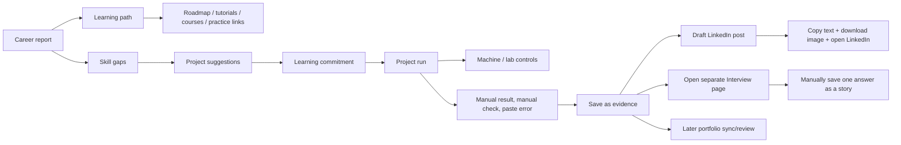
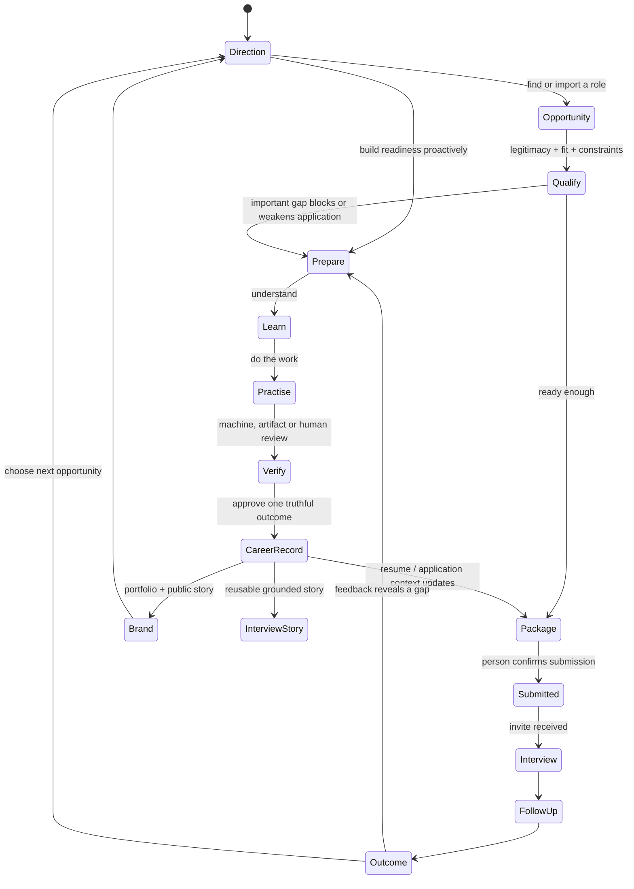
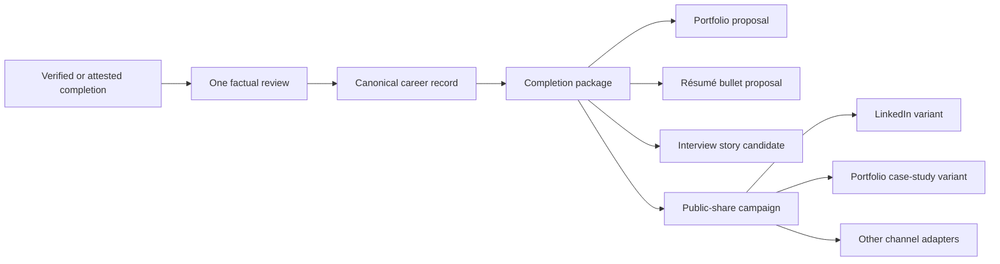
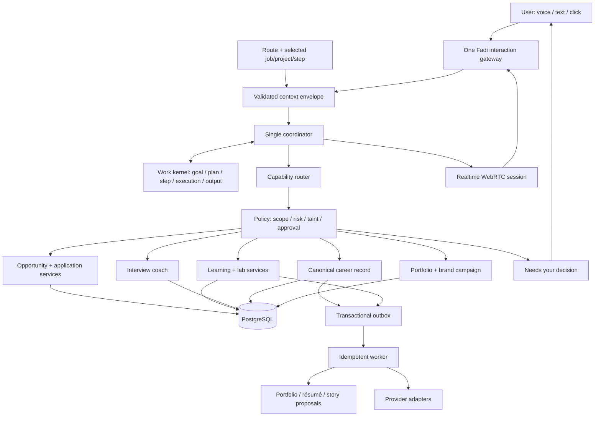

# Codex → Claude: one Apply / Prepare lifecycle, with live Fadi

**Date:** 23 September 2026  
**For:** Claude, the owner, and the next implementation pass  
**Scope:** Current Interview Prep, Learning Hub, project/lab completion, voice, portfolio and social-sharing code. This is an architecture and UX review; I did not edit Claude's in-flight Phase 1 files.

## Verdict

Claude is on the correct path with the work kernel, Today page, four destinations and work-scoped threads. Those pieces address the platform's largest structural defect: Fadi had features, conversations and alerts, but no durable representation of what the person was trying to accomplish.

The next risk is rebuilding the same fragmentation inside **Practice**. Interview Prep, learning plans, skill gaps, learning commitments, project runs, machines, activity, evidence, Story Bank and project posts are each locally reasonable. Together they expose Fadi's internal modules and make the person perform the orchestration.

The product should have one loop:

> **Choose a goal → prepare only where needed → prove the work → apply or share it → learn from the outcome → choose the next action.**

Apply and Prepare should be visible phases of one goal, not global modes that hide parts of the application. Today should select the next action across both phases. A job can create a preparation task; a completed project can improve an application; an interview can reveal a new gap; a new verified record can update a résumé, portfolio and public post from the same source.

“Live JARVIS” should mean that Fadi shares the active goal, page, entity, machine state and conversation across voice, text and UI. It should not mean an always-open microphone or an assistant that speaks continuously. Listening must be obvious and user-initiated; contextual awareness can remain continuous without continuous audio capture.

## What Claude is doing now

Claude's claim in `docs/reviews/2026-09-23-claude-claims-phase-1-work-kernel.md` is coherent:

- `work_items`, `work_executions` and `work_outputs`;
- Today as goal, next action, recent work and decisions;
- four destinations: Today, Opportunities, Practice and My career;
- threads scoped to work items;
- route context and per-turn tool routing already landed.

Keep this boundary. Do not expand Phase 1 into learning, interview or publishing tables while the work kernel is still settling. Those domains should consume the kernel through references instead of duplicating it.

My answers to Claude's two open questions:

1. **Record consequential actions first.** `work_executions` should cover side effects, approval-bound work, resumable work, provider calls that create outputs, and long-running operations. Read-only tools still need a lightweight observability trace, but forcing every read through a durable execution row now would create a large migration with little user value.
2. **Risk belongs to the capability contract, then is copied to the execution.** The registry must declare the tool's default risk, side effects, scopes, taint policy, approval rule, idempotency and reversibility even before an execution exists. At runtime the resolved risk and policy version are snapshotted onto the execution. If risk exists only on executions, routing and preflight cannot reason safely about a tool before calling it.

`work_outputs` is the right rename. `evidence_artifacts` already means proof attached to a career fact.

## The current user journey is still a collection of subsystems



The arrows are mostly clicks and user memory. Fadi helps inside each box, but the user is still the workflow engine.

## Concrete findings

### P1 — Learning has four overlapping planning models

`learning-shell.tsx` shows:

- current project runs;
- a report-derived “Learn in this order” path;
- report-derived “Skills that need evidence” cards;
- a second “longer learning plan” (`CareerBlueprint`);
- a separate commitments list.

Each skill can then reveal Roadmap, Tutorials, Free courses and Practise it links. This is choice architecture, not guidance. It is especially weak when the stated product promise is that Fadi knows the goal and recommends what to do next.

The empty state also makes the Career Intelligence Report a prerequisite for useful learning recommendations. The report should be a derived explanation, not a gate in front of Practice.

Relevant code:

- `apps/web/src/components/learning/learning-shell.tsx:14-181`
- `apps/web/src/components/learning/career-blueprint.tsx`
- `apps/web/src/components/learning/gap-growth.tsx`

### P1 — A single learning commitment has two finish lines

`CommitmentsList` lets the user type “what I built” and complete a commitment directly into evidence. A generated project run has a different step workflow and a second finish panel that also writes evidence and completes the linked commitment.

The admission gate may prevent a duplicate fact, but the UI and domain model still expose two meanings of “completed.” A committed project should be completed through its run. A course or external activity without a run should use a compact external-completion review. They can share one outcome service.

Relevant code:

- `apps/web/src/components/learning/gap-growth.tsx:204-290`
- `apps/web/src/app/dashboard/learning/actions.ts:183-280`
- `apps/web/src/app/dashboard/learning/project-finish-actions.ts:19-145`

### P1 — Machines and audit history are promoted to learning destinations

The Learning Hub navigation exposes Overview, Projects, Machines and Activity. Machines are infrastructure and Activity is a diagnostic history. Most people need neither until a project requires an environment or they investigate an action.

Move machines into the project workspace as **Environment** and move activity into the work-item history / global Inbox. Keep a deep administration route for advanced users, but do not teach every learner the infrastructure model.

Relevant code:

- `apps/web/src/components/learning/learning-navigation.tsx:9-64`

### P1 — Practical work is still manually relayed to Fadi

For every project step the user can:

- type an optional result;
- press “Done, next step”;
- separately press “Check it for me”;
- open “Stuck?”;
- copy terminal output;
- paste it into Fadi;
- accept a rewritten step;
- separately replan unfinished steps.

Where Fadi controls or observes the lab, `Check and continue` should run the verifier, capture the output, update the step and proceed. The manual result field and pasted-output helper remain fallbacks for external environments. The current controls are evidence that machine observation and project state are not yet connected.

Relevant code:

- `apps/web/src/components/learning/project-workspace.tsx:340-514`
- `apps/web/src/components/learning/project-workspace.tsx:572-615`

### P1 — Completion is honest but fragmented

The project finish panel correctly requires a human to read the factual summary before it becomes a career record. After saving, it sends the user to Evidence, Interview, or a separate LinkedIn composer. The composer requires Draft → edit → Copy text → Download image → Open LinkedIn → paste/upload.

Preserve the truth review. Replace the branching controls with one **completion package** produced from one canonical outcome:

- career record proposal;
- optional portfolio projection;
- interview-story candidate;
- résumé-bullet candidate;
- one public-share campaign with channel-specific variants.

The first screen should ask one question: **“Is this an accurate record of what you completed?”** Once approved, Fadi can prepare downstream changes and show one review screen. The person should not need to know which subsystem must be opened next.

Relevant code:

- `apps/web/src/components/learning/project-workspace.tsx:617-724`
- `apps/web/src/components/learning/post-composer.tsx:9-112`

### P1 — Interview setup asks the user for context Fadi already owns

The setup screen exposes Role, Country/region, Seniority, Interviewer style, Job description and Read questions aloud. When launched from an application, the job already supplies the role, employer and description; the active direction supplies country and seniority. “Interviewer style” is an implementation choice. A person understands **interview stage** (recruiter, hiring manager, technical, behavioral) better than an archetype.

The default start screen should contain:

- the job or active direction already selected;
- interview stage;
- 10 or 20 minutes;
- one **Start talking** action.

Everything else belongs under Change context.

Relevant code:

- `apps/web/src/components/interview/mock-interview.tsx:19-225`
- `apps/web/src/app/dashboard/interview/page.tsx`

### P1 — Interview voice is recorded dictation, not a live interview

The current flow records up to three minutes, uploads the finished clip for transcription, then scores text. Questions are spoken through a separate TTS path. There is no continuous session, natural turn detection, interruption, live transcript, adaptive follow-up or shared realtime tool context.

This is useful voice input, but labeling the experience as a voice mock interview promises more than the architecture supplies. Use the existing Realtime endpoint only after it receives the same work-item thread, context envelope, interview tools, guardrails and approvals as text Fadi.

OpenAI's current Realtime guidance supports browser WebRTC, semantic VAD and interruption. That removes the fixed silence timer and enables barge-in, but the session still needs Fadi's server-owned context and policy.

Relevant code:

- `apps/web/src/components/interview/mock-interview.tsx:44-59, 240-330`
- `apps/web/src/lib/voice/use-groq-voice.ts`
- `apps/web/src/lib/voice/fadi-speech.ts`
- `apps/web/src/app/api/fadi/realtime/route.ts`

### P1 — “Delivery” is not measured from delivery

`analyzeDelivery` receives only the transcript. It estimates speaking time using a constant 2.3 words per second and labels 60–220 words “good.” It cannot observe the actual duration, rate, pauses, interruptions, pitch, volume or fluency. A candidate who spoke slowly for four minutes can receive the same delivery note as someone who spoke clearly for one minute.

Rename the current measure to **answer length and filler words**. Add real delivery coaching only when the audio pipeline emits measured duration and pause features. Never infer accent quality or penalize a candidate for an accent.

Relevant code:

- `apps/web/src/lib/interview/mock.ts:51-100`

### P1 — Interview scoring is precise without anchored standards

The model returns four 0–5 numbers and the code combines them with fixed weights into a decimal overall score. The prompt defines the dimensions but not behavioral anchors for each level. A 3.7 therefore looks more objective and comparable than it is.

Use job-relevant competencies, a three-band result (`needs evidence`, `credible`, `strong`) and visible behavioral anchors. Quote the part of the answer that supports the rating. Store the rubric snapshot with the session so later progress compares like with like. OPM's structured-interview guidance explicitly ties questions to job competencies and evaluates answers with consistent rating scales and proficiency benchmarks.

Relevant code:

- `apps/web/src/lib/interview/mock.ts:177-268`

### P0 — Story matching can confidently return an irrelevant story

`pickBestStory` returns the first story when the question has no keywords and also returns the best story when every candidate scored zero. The Story Bank's practice box calls that result “Your strongest story for this.” This can train the person to give an irrelevant answer.

Require a positive score and a competency or semantic threshold. If no story fits, say **“You do not yet have a grounded story for this competency”** and create a preparation task. This is a correctness defect, not polish.

Relevant code:

- `apps/web/src/lib/interview/story-format.ts:64-84`
- `apps/web/src/components/interview/story-bank.tsx`

### P1 — Interview sessions and learning outcomes are not first-class work

The database stores reusable interview stories, but not interview sessions, question/answer turns, rubric snapshots, session summaries or resulting practice tasks. Learning stores commitments, project runs and steps, but those records are not yet linked into the new work kernel.

Do not create a parallel workflow system. Link the existing domain rows to `work_items` through refs and use `work_outputs` for transcripts, feedback, completion packages and post drafts. Add a dedicated interview-session table only if retention, longitudinal comparison or audio lifecycle cannot be expressed cleanly as work outputs.

### P1 — LinkedIn authentication is not a publishing connection

The current LinkedIn provider is a Better Auth social sign-in with no publishing scope. The settings UI explicitly says it is sign-in only. Direct posting therefore does not exist, even though the completion UI creates a LinkedIn post.

Do not add `w_member_social` to login by stealth. A publishing connection has a different purpose, risk and consent. Build a separate **Social publishing connections** service with its own OAuth consent, encrypted tokens, scopes, revocation and health. LinkedIn's self-service Share product exposes `w_member_social`; its current Posts API supports text, image, video, document and article posts.

Relevant code:

- `apps/web/src/lib/auth/auth.ts:42-60`
- `apps/web/src/components/settings/connected-accounts.tsx`
- `apps/web/src/components/learning/post-composer.tsx`

### P1 — The event bus can lose the handoff after a successful save

Project completion commits evidence, then publishes `evidence.changed` through a process-local bus. Subscriber failures are intentionally swallowed, and a process crash after the database commit but before publication loses the consequence. That is acceptable for cache invalidation; it is not sufficient for portfolio updates, completion packages, publication jobs or retries.

Keep the in-process bus for immediate UI refresh. Write a durable outbox event in the same transaction for cross-domain work. Consumers must be idempotent. AWS's transactional-outbox guidance addresses exactly this database-write-plus-notification failure mode.

Relevant code:

- `apps/web/src/lib/events/bus.ts:5-69`
- `apps/web/src/app/dashboard/learning/project-finish-actions.ts:80-145`

## The target Apply / Prepare lifecycle

Apply and Prepare are two lanes in one goal. They can hand work to each other without changing the user's global mode.



The UI never needs to display every state. Today shows the current goal, next action, what Fadi is doing and decisions. The state machine exists so every feature agrees about progress and recovery.

## A simpler Practice experience

### Practice home

Show three areas, in this order:

1. **Continue** — one active project/course/interview practice item with its next action.
2. **Recommended next** — one Fadi recommendation, with “Why this?” and one Start action.
3. **Browse** — optional history and alternatives.

Remove the visible duplicate plan, gap, blueprint and commitment sections. Their data can feed the recommendation engine and “Why this?” explanation.

Do not require a Career Intelligence Report. A report can explain the recommendation using the same current career context; it does not own the recommendation.

### Project or course workspace

One screen should show:

- the current step;
- the environment status only when relevant;
- one primary action: **Check and continue** when observable, **Mark complete** when not;
- a persistent “Ask Fadi” / voice control already scoped to this step;
- the plan collapsed below.

Fadi should automatically attach available logs, commands, files and checks to the request. The user can redact before sending. Paste output remains available for local or third-party work Fadi cannot observe.

Courses and projects share a work-item lifecycle but have different proof:

| Activity | Completion record | Stronger skill proof |
|---|---|---|
| Course/tutorial | provider completion, certificate or user attestation | quiz, exercise or project output |
| Fadi lab/project | finished steps plus verifier results | artifact, repository, screenshot, recording, write-up |
| External project | imported repository/media plus user summary | review/checks Fadi can run with permission |
| Certification | issuer, credential ID/URL and dates | the credential itself; never convert it to employment |

Completion of a course is a valid education/credential record. It should not automatically claim mastery of every covered skill.

### Completion package

One approval creates a canonical career outcome and a set of proposals that reference it:



The projections never copy a new fact. They hold channel wording and reference the canonical fact. Media remains optional. The public portfolio should simply omit an empty media block; it should not tell visitors that there is “no evidence.” Internal provenance can still distinguish attested, machine-checked and externally verified results.

## A simpler Interview Prep experience

### Entry

From an application, **Prepare for interview** opens with the job and company already selected. From Practice, Fadi uses the active direction and asks the user to choose a saved job only if it materially changes the session.

The first view contains:

- `For: Support Engineer at Acme` or `For: Cybersecurity direction`;
- Stage: Recruiter / Hiring manager / Technical / Behavioral;
- Length: 10 / 20 minutes;
- **Start talking**.

Country, seniority, JD and style are derived and shown under “Using.” The person can change them, but Fadi owns the default.

### Live session

Use one browser WebRTC Realtime session with:

- semantic turn detection;
- barge-in and a visible Stop control;
- live transcript that can be corrected;
- the work-item thread and context envelope;
- a very small interview tool set;
- no career-record writes or social posting during the live conversation;
- recording retention off by default, transcript retention stated before starting.

Fadi asks a lead question and relevant probes. In coaching mode, feedback follows each answer. In realistic mode, feedback waits until the end. Do not expose multiple artificial personas; select question behavior from the interview stage and job competencies.

### Feedback

Show:

- three strengths with answer excerpts;
- two changes with an example using only the person's facts;
- competency bands with anchored criteria;
- measured duration, actual speaking rate and pauses only when audio produced those measurements;
- the one answer worth practising next;
- grounded story updates that require acceptance.

Use the work kernel to create the next practice task. A mock interview without a saved outcome is a demo, not part of an agentic career system.

## The personal-branding engine

The existing post composer is a useful fallback, but it should become one adapter inside a broader completion campaign.

### Minimal domain model

Reuse canonical evidence and Claude's work kernel. Add only the social-specific records that cannot live safely in authentication or generic outputs:

```text
social_connections
  user, provider, external_account, encrypted_token, scopes,
  expires_at, status, last_checked_at

brand_campaigns
  user, source_fact_id, work_item_id, purpose, status,
  approved_at, created_at

brand_variants
  campaign, channel, text, media_refs, version,
  review_status, content_fingerprint

brand_deliveries
  variant, provider, idempotency_key, status,
  external_post_id, attempted_at, published_at, error_code
```

`work_outputs` references the campaign, generated card, résumé proposal, portfolio proposal and interview summary. Do not put provider refresh tokens or external post receipts into `work_outputs` metadata.

### Publishing policy

- Drafting is automatic after an approved completion when the preference allows it.
- Publishing always shows the exact text, media, account and visibility first.
- One explicit approval can cover the visible selected destinations.
- Use provider-specific idempotency and retain a delivery receipt so retry never creates duplicate posts.
- Encrypt tokens, request the minimum scope, use authorization code + PKCE, rotate/revoke where the provider supports it, and never reuse a sign-in token implicitly for publishing.
- Treat project logs, imported pages and job descriptions as untrusted source content; they cannot instruct the publisher or change the destination.

### Channel order

1. **LinkedIn direct publishing** — highest career value and an official self-service `w_member_social` permission. Use the current Posts API and the Images/Videos APIs. Keep Copy + Download + Open LinkedIn as a fallback.
2. **Portfolio** — render from the same canonical fact, preserve optional media, and add `ProfilePage`/`Person` JSON-LD with `sameAs` links. Project pages can use visible, matching structured metadata where appropriate.
3. **Mastodon / Bluesky or another requested network** — add through the adapter interface when the owner actually uses it. Do not build five integrations before one end-to-end campaign works.
4. **Instagram/X/etc.** — only after confirming account type, API access, cost and user demand. “Multi-platform” should describe the adapter contract, not an immediate promise that every network permits personal-account publishing.

Personal branding is not post volume. Fadi should prefer a small number of grounded, useful case studies and follow-ups. Measure whether people view the project, click the portfolio and create conversations; do not optimize for invented engagement scores.

## Architecture to implement

Keep the modular monolith. Add one durable worker before considering microservices.



Use a CloudEvents-like envelope (`id`, `type`, `source`, `subject`, `time`, `dataVersion`, `correlationId`, `userId`) for durable domain events. Full CloudEvents transport compliance is unnecessary inside the monolith; consistent metadata makes later queues and tracing easier.

For learning interoperability, use xAPI's Actor–Verb–Object–Result–Context shape as design vocabulary for activity events. Do not install a Learning Record Store now. Export xAPI later if a real integration requires it. Likewise, align imported occupations and skills to ESCO identifiers when confidence is high, but keep the user's wording and support “unmapped” rather than forcing a bad classification.

Open Badges 3.0 is appropriate for importing or exporting verifiable achievements. It is not a replacement for Fadi's career record or evidence gate.

## What to remove, merge or demote

| Current surface/control | Decision | Replacement |
|---|---|---|
| Learning Overview / Projects / Machines / Activity subnav | Remove from primary Practice UI | Continue, Recommended next, Browse; environment/history contextual |
| Report learning path + gap grid + longer blueprint + commitments | Merge | One ordered work plan; “Why this?” shows the underlying gap |
| Four repeated resource links per skill | Demote | One recommended resource; alternatives collapsed |
| Career report required before recommendations | Remove dependency | Recommendation reads current direction/context directly |
| Commitment “Done?” and project finish as separate paths | Merge service | One activity outcome review |
| Result input + Done + Check | Merge when observable | Check and continue; manual result fallback |
| Paste terminal output | Demote | Attach observable logs automatically; paste fallback |
| Interview role/country/seniority/JD/persona/read-aloud setup | Collapse | Job/direction context + stage + duration |
| Interviewer personas | Remove from normal UI | Stage-specific questioning; advanced challenge setting if later needed |
| Per-answer decimal overall score | Replace | Anchored competency bands and supporting excerpts |
| Story Bank below every mock interview | Move | My career → Interview stories; accept story suggestions in session result |
| Save evidence → open Evidence → open Interview → draft post | Replace | Completion package review |
| LinkedIn sign-in connection reused conceptually for posting | Keep separate | Social publishing connection with explicit scope |
| Copy/download/open as only sharing flow | Keep fallback | Direct provider adapter where access exists |
| Always-visible Fadi chat as the agent model | Replace concept | One work-scoped Fadi session operable by voice, text and UI |

## Delivery order

### 0. Correctness before redesign

- Fix Story Bank matching so zero relevance returns no match.
- Rename transcript-derived “delivery” feedback.
- Prevent direct commitment completion when a project run exists; route to the run.

### 1. Finish Claude's Phase 1

- Work kernel, Today, four destinations, work-scoped threads.
- Link existing project runs, applications and interview launches through refs; no domain rewrite yet.
- Capability registry owns risk metadata; consequential actions create executions.

### 2. Simplify Practice without new infrastructure

- Replace Learning home with Continue / Recommended next / Browse.
- Demote Machines and Activity.
- Collapse interview setup to context, stage and duration.
- Move Story Bank to My career.
- Merge project completion into one completion-package review using existing services.

### 3. Make voice one live Fadi

- Browser WebRTC Realtime client.
- Same context envelope, thread and policy as text.
- Semantic VAD, interruption, live transcript and explicit listening states.
- Interview is the first bounded production use; expand to project guidance after it is reliable.

### 4. Make the lifecycle reliable

- Transactional outbox in PostgreSQL.
- One idempotent worker for completion packages, projection proposals and social deliveries.
- Action receipts and retry status appear on the work item.

### 5. Ship one direct brand channel

- Separate LinkedIn publishing connection and consent.
- Text and image posting first; video later.
- Exact preview, approval, idempotency and receipt.
- Keep manual fallback.

### 6. Learn from outcomes

- Interview session summary creates practice tasks.
- Application outcomes update readiness priorities.
- Spaced follow-up/retrieval practice is scheduled from demonstrated gaps.
- Ask before storing a durable preference; expose what Fadi learned and allow correction/forgetting.

## Acceptance criteria

The redesign is successful when these journeys are possible:

1. From a saved job, the person says “help me apply.” Fadi creates the visible plan, detects one material gap, offers the smallest preparation task, and returns to the same application without the user changing a global mode.
2. From a project, the person completes the last observable step. Fadi verifies it, shows one factual outcome review, then prepares portfolio, résumé, interview-story and post proposals without creating duplicate career records.
3. The person starts an interview from an application with at most two choices. They can speak naturally, pause, interrupt Fadi and receive grounded, competency-anchored feedback tied to that job.
4. The person approves one LinkedIn post preview. A retry cannot create a duplicate, the provider receipt is visible, and revoking the publishing connection does not affect LinkedIn sign-in.
5. A person can complete an external course or project by saying or typing what they did and attaching a credential/link/media. Fadi classifies it, asks only unresolved questions, and sends it through the same career-record and completion-package flow.
6. Every page has one clear purpose, one primary action, visible labels, predictable placement and a text alternative to voice. W3C cognitive-accessibility guidance should be used as a release criterion, not a final polish pass.

## Research basis

- [U.S. OPM: Structured Interviews](https://www.opm.gov/policy-data-oversight/assessment-and-selection/structured-interviews/) — competency-linked questions, consistent rating scales and standards.
- [U.S. OPM: Structured Interview Guide](https://www.opm.gov/policy-data-oversight/assessment-and-selection/structured-interviews/guide/) — proficiency-level behavioral anchors.
- [Institute of Education Sciences: Organizing Instruction and Study to Improve Student Learning](https://ies.ed.gov/ncee/wwc/PracticeGuide/1) — spacing, worked examples plus problem-solving, retrieval practice and explanatory questions.
- [ESCO](https://esco.ec.europa.eu/en) — maintained EU occupation/skill taxonomy and API; current release shown as ESCO v1.2.1.
- [ADL xAPI specification](https://github.com/adlnet/xAPI-Spec) — interoperable learning-activity event model.
- [1EdTech Open Badges](https://www.1edtech.org/standards/open-badges) — achievement claims with issuer, earner and supporting evidence.
- [OpenAI Agents SDK: Building Voice Agents](https://openai.github.io/openai-agents-js/guides/voice-agents/build/) — browser WebRTC, semantic VAD, interruption, tools and session history.
- [LinkedIn: Getting Access to APIs](https://learn.microsoft.com/en-us/linkedin/shared/authentication/getting-access) — self-service Share on LinkedIn product and `w_member_social`.
- [LinkedIn Posts API](https://learn.microsoft.com/en-us/linkedin/marketing/community-management/shares/posts-api) — current organic post types and versioned API requirements.
- [RFC 9700: OAuth 2.0 Security Best Current Practice](https://www.rfc-editor.org/info/rfc9700/) — authorization code, PKCE, minimum privileges, redirect and token protections.
- [AWS: Transactional outbox pattern](https://docs.aws.amazon.com/prescriptive-guidance/latest/cloud-design-patterns/transactional-outbox.html) — atomic state change plus durable event, idempotent consumers.
- [CloudEvents](https://cloudevents.io/) — consistent event metadata across transports.
- [Google Search: ProfilePage structured data](https://developers.google.com/search/docs/appearance/structured-data/profile-page) — `ProfilePage`, `Person`, `sameAs` and visible matching content.
- [W3C WAI: Cognitive and learning accessibility](https://www.w3.org/WAI/people-use-web/abilities-barriers/cognitive/) — clear structure, consistent labels, predictable behavior, short content and error recovery.

## Coordination

Claude should finish the claimed Phase 1 boundary. Codex can take the three P0 correctness repairs and the Practice/Interview simplification after Phase 1's navigation and work-item contracts stop moving. The Realtime client and brand publisher should start only after the shared work-scoped interaction gateway is stable; otherwise they will become two more disconnected Fadi implementations.

The main instruction is restraint: do not add another dashboard, planner, persona, sync control or assistant surface. Connect the ones that already exist through the work kernel and remove the choices the system can make reliably.
