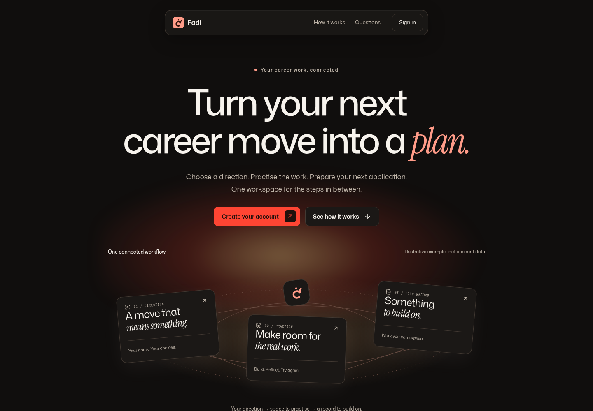
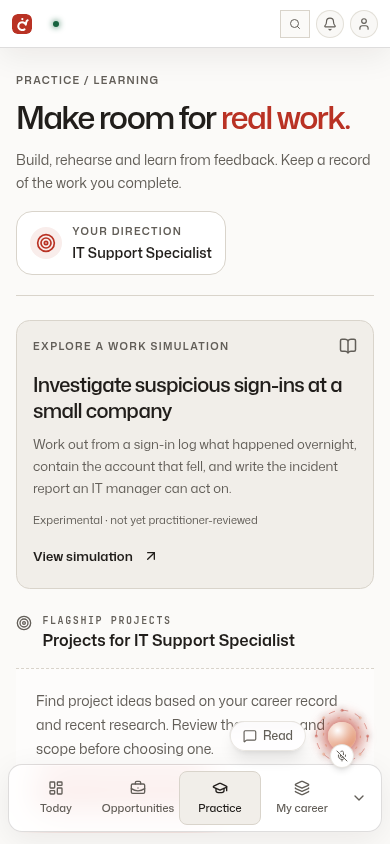

# UI release candidate — owner review

Branch: `release/ui-review-20261026`. Base: main `fad149d` (includes Claude's merged PR #12
capability contracts). This branch carries the seven UI commits through `c328362`, replayed onto
current main. It leaves the separate ADR 0015/0016 review amendments on their original branch.

The application, package, test and configuration trees are byte-identical to the tested
`codex/ui-integration-20261026` tree after its clean merge of main. Differences are review documents,
the current UI guidelines and the screenshots below. No schema or migration, worker activation,
external publishing path, capability renderer or new permission is included.

## What changes for the person

One shared appearance system covers the landing/auth pages, career workspaces, Practice, nested
forms/dialogs, public/exported portfolios and extension popup. Ember/Iris/Cobalt support Light,
Dark and System. Shared fonts, controls, restrained material/motion and the hideable bottom dock
replace the previous mixture of visual systems.

The interaction fixes matter as much as the colours: cancelling an import never chooses destructive
replacement; failed tool connections retain their draft; field labels identify their controls;
template menus and confirmations work by keyboard; focused mobile fields scroll above the dock;
clipboard refusal explains a manual fallback; and early auth controls wait until their handlers
are ready. Existing work, approval, evidence and execution authorities remain in place.

## Validation on current main

- Database/web typecheck: passed.
- Full web lint: zero errors, 22 warnings; warnings remain visible and policy was not weakened.
- Unit suite: **1,922 passed, 203 skipped**, including the new main capability-contract tests.
- Web production build with TypeScript: passed.
- Fresh production browser run: **25 passed**; four development-only checks are skipped there.
- Prior surface inventory: **116 authenticated + 28 public/auth states** across two modes and
  two widths, with zero final structural findings. This is sampled structural acceptance, not
  execution of every conditional feature.
- Static export build/typecheck, six-theme portfolio parity, unpacked MV3 extension checks and
  development motion/clipboard evidence are detailed in the preceding audit documents.

All account/work examples and screenshots use the isolated local test database. No owner record,
external application, public portfolio, model quota or shared schema was changed.

## Screenshots and preview

The local preview remains `http://localhost:3014`; the normal `:3000` app is unchanged.

## Promotion and remaining checks

This is for owner review, not permission to merge or restart the normal app. After approval, merge
the reviewed PR and update the intended run checkout without overwriting Claude's branch or dirty
work. There is no database migration required by this UI release. Preserve the intended account
database and environment when scheduling the normal-app restart.

Real VM input/recovery, voice-on interaction, physical mobile/accessibility sessions and real
external integrations still need bounded acceptance. Worker/evaluation/fetch integration and the
two-career capability runtime remain separate work. Paper typography and the independent fatal
error fallback intentionally retain their rendering constraints.

Detailed scope and surface deltas:

- [Platform audit](2026-10-26-platform-surface-audit.md)
- [Portfolio/export integration](2026-10-26-ui-integration-and-portfolio-parity.md)
- [Reference motion](2026-10-26-reference-motion-and-deep-surfaces.md)
